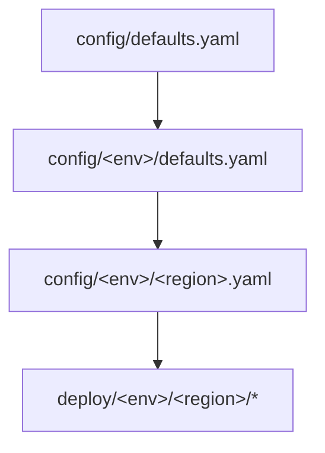

# Rosa Seaplane - Claude Instructions

## Project Overview

The **ROSA Seaplane** is a strategic redesign of Red Hat OpenShift Service on AWS (ROSA) with Hosted Control Planes (HCP). This project transforms ROSA from a globally-centralized management model to a **regionally-distributed architecture** where each AWS region operates independently with its own control plane infrastructure.

**Key Goals:**

- **Regional Independence**: Each region operates autonomously with its own cluster lifecycle management service to reduce global dependencies
- **Operational Simplicity**: GitOps-driven deployment with zero-operator access model
- **Modern Cloud-Native Architecture**: Built on AWS services (EKS, RDS, API Gateway)
- **Disaster Recovery**: Declarative state management with cross-region backups

## Architecture Overview

### Three-Layer Regional Architecture

1. **Regional Cluster (RC)** - EKS-based cluster running core services:
   - Platform API (customer-facing with AWS IAM auth)
   - Seaplane Operator - postgres-based cluster lifecycle controller
   - kube-applier - DynamoDB-backed resource distribution to MCs
   - ArgoCD - GitOps deployment
   - Tekton - infrastructure provisioning pipelines

2. **Management Clusters (MC)** - EKS clusters hosting customer control planes:
   - Run HyperShift operators hosting multiple customer control planes
   - Dynamically provisioned and scaled per region
   - Private Kubernetes APIs with no network path to RC (ideal state)

3. **Customer Hosted Clusters** - ROSA HCP clusters with control planes in MC

## Key Technologies

- **Compute**: Amazon EKS (Regional + Management Clusters)
- **Networking**: VPC, API Gateway (regional), VPC Link v2, ALBs
- **Storage**: Amazon RDS (seaplane-db), Amazon ElastiCache Valkey (rate limiting), EBS volumes
- **Identity**: AWS IAM for authentication and authorization
- **Infrastructure**: Terraform modules with GitOps patterns
- **CI/CD**: ArgoCD (apps), Tekton (infrastructure pipelines)
- **Resource Distribution**: kube-applier (DynamoDB-backed controller applying resources to MCs)
- **Languages**: Go (primary backend), Shell scripting
- **Container Orchestration**: Kubernetes via EKS

## Project Tracking

Work for the ROSA Seaplane is tracked in Jira under two parent Outcomes:

- **[HPSTRAT-62](https://redhat.atlassian.net/browse/HPSTRAT-62)** ("ROSA V2 (Seaplane) - FedRAMP Class C Assessment"): The FedRAMP Class C minimum viable product (Class C baseline + HCP on EKS) — platform readiness, security/compliance controls, evidence collection, and operational readiness required for Class C certification. Completion requires certification, not GA of the broader V2 offering.
- **[HPSTRAT-758](https://redhat.atlassian.net/browse/HPSTRAT-758)** ("ROSA V2 (Seaplane) - Greenfield General Availability"): Feature-driven work to bring the regional platform to GA for new (greenfield) cluster deployments.

Day-to-day engineering tasks (epics, stories, bugs) live in the **ROSAENG** project under the **[ROSA] Seaplane** team (`customfield_10001`, id `0c538cd9-152b-49f6-ad7c-e2fa2f865809`).

When creating ROSAENG issues:

- Set the team via `additional_fields`: `{"customfield_10001": "0c538cd9-152b-49f6-ad7c-e2fa2f865809"}`
- Do **not** set a component

## Development Guidelines

### Agent Usage

- **ALWAYS use the architect agent** for changes to:
  - `docs/design/`
  - Any architectural decisions or patterns
- **Use adversary agent** for security review of code changes (supply chain, infrastructure, application security)
- **Use code-reviewer agent** for code quality review
- **Use ci-troubleshooter agent** for diagnosing CI/CD failures
- **Use documentation-updater agent** for reviewing documentation freshness

### Architecture Patterns

- **GitOps First**: ArgoCD for cluster configuration management, infrastructure via Terraform
- **Private-by-Default**: EKS clusters use fully private architecture with ECS bootstrap
- **Declarative State**: Seaplane Operator (backed by seaplane-db) maintains single source of truth for all cluster state
- **Event-Driven**: kube-applier reads desire documents from DynamoDB (written by seaplane-operator) and applies them to MCs via seaplane-dynamo GSI polling
- **Regional Isolation**: Each region operates independently with minimal cross-region dependencies
- **Explicit Feature Flags**: Optional or environment-specific infrastructure (e.g., CloudTrail, PagerDuty, resources with per-account limits) should be gated behind `enable_*` configuration flags. Avoid patterns like checking against the environment's name to change behavior or functionality.
  - Feature flags should default to what keeps the best developer experience — focus on the lowest barrier to getting a new region started. We'd rather have verbose production configs than require developers to understand every flag just to get going.

### Key Design Decisions

- **Bootstrap Strategy**: Use ECS Fargate for private EKS cluster bootstrap (see `docs/design/fully-private-eks-bootstrap.md`)
- **No Public APIs**: All EKS clusters are fully private with VPC-only access
- **ArgoCD Self-Management**: Clusters manage their own ArgoCD installations via GitOps
- **Rate Limiting**: Per-account rate limiting at the Platform API layer using GCRA algorithm with ElastiCache Valkey as shared counter store (see `docs/design/rate-limiting-architecture.md`)

### Repository Structure

```
terraform/
├── modules/eks-cluster/        # EKS with private bootstrap
├── modules/ecs-bootstrap/      # Fargate bootstrap tasks
└── config/                    # Cluster configuration templates

argocd/
├── config/                   # Live Helm chart configurations
│   ├── management-cluster/   # MC application templates
│   ├── regional-cluster/     # RC application templates
│   └── shared/              # Shared configurations
└── README.md

.chai-bot/                    # Chai Bot scheduled tasks
├── rosa_seaplane_adversary_scan.md             # On-demand single-repo adversary security scan
├── rosa_seaplane_ci_daily_health_report.md     # Daily CI health report
├── rosa_seaplane_ci_weekly_status.md            # Weekly Jira epic progress + PR stats
├── rosa_seaplane_docs_update.md                 # Weekly doc staleness detection & update PRs
└── rosa_seaplane_weekly_security_report.md      # Weekly consolidated adversary scan across all repos

docs/
├── README.md                 # Architecture overview
├── FAQ.md                   # Architecture decisions Q&A
├── design/                  # ADRs (Architecture Decision Records)
├── environment-provisioning.md
├── hostedcluster-provisioning.md  # User-facing: create & access a hosted cluster
├── hostedcluster-teardown.md     # Admin-only: manual teardown & force cleanup
├── development-environment.md
├── adding-component-pre-merge.md
└── sop/                     # Standard operating procedures
```

### Development Workflow

#### For Infrastructure Changes

1. Update Terraform modules in `terraform/modules/`
2. Run `make pre-push` before committing or pushing — this is the all-in-one command that runs
   `terraform-fmt`, `check-docs`, `check-rendered-files`, `helm-lint`, and `terraform-validate`,
   matching the full CI suite. Individual targets (e.g. `make terraform-fmt`) can still be used
   for targeted runs.
3. Ensure architect agent reviews any architectural changes

#### For Application Changes

1. Update ArgoCD configurations in `argocd/`
2. Follow GitOps patterns - ArgoCD will sync changes
3. Test in development region first
4. Run `make pre-push` before pushing — `check-docs` (prettier markdown) and other non-Terraform
   checks apply to all change types

#### For New Regions

1. Add region config to `config/<environment>/` and render with `uv run scripts/render.py`
2. Bootstrap the central pipeline (see `docs/environment-provisioning.md`)
3. ArgoCD bootstrap handles core service deployment
4. Management Clusters auto-provision as needed
5. Run `make pre-push` before pushing to validate all rendered files and documentation

#### For Config File Changes

**IMPORTANT**: Files in `deploy/` are **generated** from `config/` templates. Never edit them directly.

When you modify any file in `config/<environment>/` (e.g., `config/stage/defaults.yaml`, `config/integration/us-east-1.yaml`):

1. **Automatically regenerate** rendered files by running:

   ```bash
   uv run scripts/render.py
   ```

   This regenerates all files in `deploy/<environment>/`, including:
   - `_merged_config.yaml` — merged view of the config hierarchy
   - `argocd-values-*.yaml` — ArgoCD Helm values
   - `argocd-bootstrap-*/applicationset.yaml` — ApplicationSet templates
   - `pipeline-*-inputs/terraform.json` — Terraform input variables

2. **Verify changes** with `make check-rendered-files` or `make pre-push`
3. **Commit both** the config source files and the regenerated deploy files together

The render script merges config from the inheritance chain:



**Never commit** changes to `deploy/` files without regenerating them from `config/` sources.

#### Ephemeral Environments

See [`docs/development-environment.md`](docs/development-environment.md) for full usage — provisioning, resync, E2E, teardown, and port forwarding.

### Security Guidelines

- **AWS IAM Only**: Use AWS IAM for all authentication/authorization
- **Private Networking**: No public endpoints except regional API Gateway
- **Least Privilege**: Follow AWS IAM best practices for service roles
- **Encryption at Rest**: KMS-encrypted EKS secrets, RDS, and EBS volumes
- **Network Segmentation**: Dedicated security groups for VPC endpoints and services
- **High Availability**: Multi-AZ NAT Gateways eliminate single points of failure
- **Break-Glass Access**: Use ephemeral containers for emergency access only

### Formatting

- **Markdown**: All markdown files must be formatted with `prettier`. Run `npx prettier --write '**/*.md'` before committing markdown changes.
- **Diagrams**: Always use Mermaid for diagrams in markdown files, never ASCII art.

### Testing and Validation

- **Pre-push (required)**: Run `make pre-push` before committing or pushing. This single command
  runs the full CI validation suite — `terraform-fmt`, `check-docs` (prettier markdown),
  `check-rendered-files`, `helm-lint`, and `terraform-validate` — matching exactly what CI will
  enforce. Skipping this step is how formatting and lint failures reach CI (e.g. PR #364).
- **Terraform Validation**: Always run `terraform validate` and `terraform plan`
- **Format Check**: `make terraform-fmt` (also run automatically by `make pre-push`)
- **Alerting Rule Tests**: `make promtool-test` validates PrometheusRule syntax and runs unit tests from `ci/promtool-test/`
- **ArgoCD Health**: Verify applications sync successfully
- **Security Review**: Use architect agent for security-sensitive changes

### Alerting Rules

Platform alerting and recording rules are defined as PrometheusRule CRs in the `alerting-rules` chart (`argocd/config/regional-cluster/alerting-rules/templates/`). Rules are evaluated by Thanos Ruler against Thanos Query. See [docs/adding-alerting-rules.md](docs/adding-alerting-rules.md) for a developer guide on adding new rules, including the error budget burn rate pattern used for SLA alerts.

### Rate Limiting

The Platform API implements per-account rate limiting using the GCRA (Generic Cell Rate Algorithm) via `go-redis/redis_rate`. Rate limit counters are stored in ElastiCache Valkey 9.1, chosen over Redis OSS for 20% lower cost, open-source licensing (BSD 3-Clause), and performance improvements.

**Architecture**: API Gateway (global throttle) → Platform API middleware (per-account GCRA) → ElastiCache Valkey (shared counters). Rate limiting runs after identity extraction but before authorization, so over-limit requests are rejected cheaply. The system fails open — if Valkey is unavailable, requests pass through.

**Key files (rosa-seaplane)**:

| File                                                       | Purpose                                                                     |
| ---------------------------------------------------------- | --------------------------------------------------------------------------- |
| `terraform/modules/elasticache-valkey/main.tf`             | ElastiCache Valkey replication group, KMS, security groups, parameter group |
| `terraform/modules/elasticache-valkey/variables.tf`        | `cluster_id`, `vpc_id`, `node_type`, `engine_version`                       |
| `terraform/modules/elasticache-valkey/outputs.tf`          | Valkey endpoint and port outputs                                            |
| `scripts/bootstrap-argocd.sh`                              | Threads Valkey endpoint from Terraform outputs to ECS bootstrap env vars    |
| `terraform/modules/ecs-bootstrap/main.tf`                  | Writes `redis_endpoint` annotation on the ArgoCD cluster secret             |
| `config/templates/argocd-bootstrap/applicationset.yaml.j2` | Reads `redis_endpoint` annotation into Helm valuesObject                    |
| `argocd/config/regional-cluster/platform-api/values.yaml`  | Rate limit config (routes, rates, burst), Valkey endpoint                   |
| `argocd/config/regional-cluster/platform-api/`             | Argo CD Application wrapper (deployment chart in rosa-seaplane-api)         |
| `argocd/config/regional-cluster/alerting-rules/templates/` | PrometheusRule CRs for rate limit alerts                                    |
| `docs/design/rate-limiting-architecture.md`                | ADR: rate limiting design decisions                                         |

**Key files (rosa-seaplane-api)**: Rate limiting Go implementation lives in the API repo — `seaplane-api/pkg/ratelimit/` (GCRA limiter, config, middleware), `seaplane-api/cmd/main.go` (wiring).

**Data flow for Valkey endpoint**: Terraform output → `bootstrap-argocd.sh` (combines host:port) → ECS task env var → cluster secret annotation → ApplicationSet valuesObject → Helm values → `REDIS_ENDPOINT` env var on platform-api pods.

### Chai Bot Scheduled Tasks

Scheduled CI/documentation tasks run via Chai Bot. Schedules are defined in `.chai-bot/`.

**Slack threading convention:** Chai Bot uses delimiters to split output into a top-level channel message and threaded replies:

- `---THREAD_DETAILS---` — everything after this line becomes threaded replies (not posted to the channel)
- `---THREAD_BREAK---` — separates individual threaded replies

**Daily CI report** tracks the `nightly-ephemeral`, `nightly-integration`, and `nightly-stage` jobs. Top-level message shows today's status + 10-day trend table. It also reports, as a single condensed header line, the latest run of the **OCP nightly e2e** periodics — the HyperShift `periodic-ci-openshift-hypershift-release-{5.0,5.1}-periodics-e2e-rosa-seaplane` jobs that run rosa-seaplane e2e against OCP nightly release images (condensed latest-run header line plus a 10-run trend row per OCP version). Threaded replies are created only when jobs are failing, using the `ci-troubleshooter` agent for root cause analysis. Fix PRs are only raised when the fix lands in a seaplane repo (`rosa-seaplane`, `rosa-seaplane-api`, `rosa-seaplane-cli`); failures rooted in HyperShift or the OCP payload are reported with a recommendation but no PR.

**Weekly status** groups epics by status (In Progress with completion %, To Do, Done) and summarizes PR activity across `rosa-seaplane`, `rosa-seaplane-api`, and `rosa-seaplane-cli`.

**Docs update** detects stale documentation across the three repos and creates PRs to fix it, using the `documentation-updater` agent for validation.

**Adversary scan** runs a weekly Groundwork-mode security scan of each repo using the `adversary` agent and posts severity-ranked findings to Slack. This is static/adversarial analysis, not CVE scanning.

### Important Files and Patterns

- `Makefile` - Standardized provisioning commands
- `bootstrap-argocd.sh` - ECS Fargate bootstrap script
- `argocd/config/shared/argocd/` - ArgoCD self-management Helm chart
- Design decisions follow ADR format in `docs/design/`
