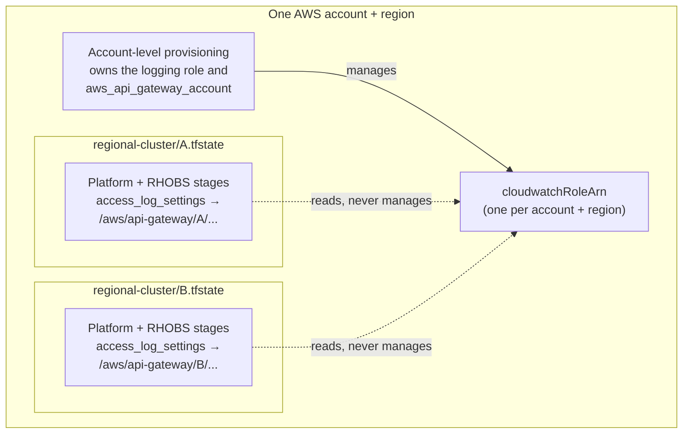

# API Gateway Account Ownership

**Last Updated Date**: 2026-11-06

## Summary

The account-level API Gateway CloudWatch logging role and the `aws_api_gateway_account` setting it backs are owned by a single account-level provisioning step, one per AWS account and region, with a lifetime longer than any regional cluster. The regional cluster module consumes the result and manages neither: it relinquishes the copies it used to own with `removed` blocks and reads the role only for an advisory diagnostic.

## Context

- **Problem Statement**: `terraform/modules/api-gateway` created an IAM role named `${regional_id}-api-gateway-cloudwatch` and pointed `aws_api_gateway_account.main.cloudwatch_role_arn` at it. `terraform/config/regional-cluster/main.tf` instantiates the module unconditionally and every regional cluster has its own Terraform state (`regional-cluster/<regional_id>.tfstate`, see [CodeBuild Provisioning](codebuild-optimization.md)), so every cluster was a competing owner of one AWS-wide value:
  - AWS stores exactly one `cloudwatchRoleArn` per account and region, shared by every REST API in the account. Both gateways in a regional cluster depend on it: the platform API stage and the RHOBS stage (`terraform/modules/rhobs-api-gateway/main.tf`), which has `access_log_settings` but no account resource of its own.
  - The newest apply won the setting: every cluster has its own state and the value is account-wide, so applies overwrite one another — a conclusion read from the configuration and state layout, not from a live account. The teardown path is worse, and is a hazard read from the provider source rather than an observed outage: in `hashicorp/aws` v6.71.0 the account resource's delete unconditionally issues `UpdateAccount` with `replace /cloudwatchRoleArn = null` and never checks whether the stored ARN is still the live one, so one cluster teardown clears the setting for every surviving cluster in the account and deletes the role it pointed at. The resulting loss of access logging — a FedRAMP AU-02 control — follows from that behaviour; it has not been measured against a live account here.
- **Constraints**:
  - The setting cannot be isolated per cluster. AWS has one per account and region; nothing about it can be namespaced.
  - Access logging must keep working. Suppressing the drift, or dropping the resource from configuration (which destroys it, performing the very reset being prevented), are not options.
  - Access log destinations must stay per-cluster: each cluster keeps its own log group and KMS key, so the handover neither merges nor redirects anyone's log data.
  - Teardown runs unattended in CodeBuild and must stay safe for states provisioned before this change.
- **Assumptions**: every regional cluster in one AWS account can share one log-delivery role. The role carries the AWS-managed `AmazonAPIGatewayPushToCloudWatchLogs` policy, whose single statement allows `logs:CreateLogGroup`, `logs:CreateLogStream`, `logs:DescribeLogGroups`, `logs:DescribeLogStreams`, `logs:PutLogEvents`, `logs:GetLogEvents` and `logs:FilterLogEvents` on `Resource: "*"` — account-wide read as well as write. Sharing it is acceptable because of who can assume it, not because its permissions are narrow (see [Security](#security)); and the policy is the same one the per-cluster roles already carried.

## Alternatives Considered

1. **`lifecycle { ignore_changes = [cloudwatch_role_arn] }`**: hides the contention in plan output and changes nothing at teardown.
2. **Drop the resources from configuration**: Terraform destroys what it no longer sees, so the first apply performs the account-wide reset itself.
3. **Keep ownership in the cluster module but make it convergent** — a shared role name, adoption on apply, detach before destroy: it removes the symptom, but every cluster state still owns the singleton, so the number of owners still grows with the number of clusters.
4. **One account-level owner, clusters consume (chosen)**: a single provisioning step per AWS account and region owns the role and the setting; clusters read and depend on them.

## Design Rationale

- **Justification**: only alternative 4 produces exactly one owner. The resource's lifetime is the account's, so its owner must be an account-level step, not something instantiated once per cluster. Clusters then have nothing to contend over and nothing to destroy.
- **Evidence**: the repository already relies on account-level prerequisites provisioned ahead of a regional cluster and consumed by it — `scripts/buildspec/provision-infra-rc.sh` reads `/infra/<region>/ou-path` from the account on every run and fails when it is absent, rather than creating it. The logging role is the same shape of dependency.
- **Comparison**: alternatives 1 and 2 leave the account-wide reset in place. Alternative 3 keeps logging working but still has N owners for one value, so correctness depends on every state agreeing forever; it was implemented and rejected for that reason.

## Architecture

Log groups, KMS keys, stage settings and `access_log_settings` destinations remain per-cluster and are created and destroyed with their cluster. Only the account-level role and setting moved.

### What the module does now

| Element                                    | Behaviour                                                                                                                                                                                                                                                                                                        |
| ------------------------------------------ | ---------------------------------------------------------------------------------------------------------------------------------------------------------------------------------------------------------------------------------------------------------------------------------------------------------------- |
| `removed` blocks (3)                       | Forget the previously owned role, attachment and account setting on the next apply, with `destroy = false` so nothing is deleted and the account setting is never reset                                                                                                                                          |
| `check "api_gateway_account_logging_role"` | Advisory only. Looks the role up by name so a missing prerequisite is named on the plan instead of surfacing as an opaque `BadRequestException` at apply, and warns when the trust policy text does not mention `apigateway.amazonaws.com`. See [Diagnostic scope](#diagnostic-scope) for what it does not check |
| `var.cloudwatch_role_name`                 | The name the prerequisite is published under; identical in every account, never derived from `regional_id`                                                                                                                                                                                                       |

No import, adoption or create-if-absent path exists in the cluster module. It cannot take ownership back.

### Diagnostic scope

`check "api_gateway_account_logging_role"` is an advisory diagnostic, evaluated on both plan and apply. It is not a gate and not a policy evaluator. It does exactly two things: it reads an IAM role by name, and it regex-matches the string `apigateway.amazonaws.com` in that role's `assume_role_policy` document.

It does **not** establish that the prerequisite is correctly configured. It does not read or validate the account's `cloudwatchRoleArn` setting, does not check that the setting points at this role or at any role, does not evaluate the trust policy's effects, actions, principals or conditions, does not confirm the managed policy is attached, does not evaluate effective permissions, and does not verify that any log event is ever delivered. A role whose trust policy merely mentions the string in a `Deny`, or under a condition that never matches, passes the check.

Treat a clean plan as "a role with this name exists and its trust policy text mentions API Gateway", nothing more. Confirming the prerequisite is actually in place requires checks against a live account, which this repository does not perform.

### Migration

`removed` relinquishes ownership **on apply**. `terraform destroy` ignores it and destroys the resource anyway (verified against Terraform 1.14.3), so the order matters:

For an AWS account with no regional cluster yet, provision the account-level owner first and there is nothing to migrate. For an account that already has clusters, migrate the clusters first: the owner's create is an `UpdateAccount` patch, so provisioning it while clusters still own copies makes the two sides flip the value back and forth until every cluster has applied.

1. **Apply this change to every cluster in the account.** Each apply forgets the three addresses without deleting anything: plan reports "will no longer be managed by Terraform, but will not be destroyed", and the apply destroys nothing. It is idempotent, and a no-op on a state that never had them. Terraform deletes nothing in this step and does not write the account setting, so whatever value the account holds is left pointing at the same role. Continuity therefore holds only if that setting is valid and the role it names still exists and still works — none of which this change verifies.
2. **Provision, or re-apply, the account-level owner** once no cluster manages the setting any more. It writes its own role uncontended; this is the step that actually moves the value.
3. **Before a pre-existing state is destroyed**, `terraform/config/regional-cluster/pre-destroy.sh` detaches the same three addresses, because step 1 may not have run for that state yet. `tf_apply` sources it on destroy only and refuses to destroy if a detach cannot be proven. The hook is transitional: delete it once every state has applied once, after which every address reports `[absent]`.

   This protects a teardown that **runs this code**. A teardown executed from a checkout that predates this change has neither the `removed` blocks nor the hook, so it still performs the account-wide reset — the original defect. `make ephemeral-teardown` destroys from the environment's own branch, so resync an environment to a branch containing this change before tearing it down; the ADR's guarantees only hold from that point. If a teardown does slip through once the owner exists, the account setting is restored by re-applying it (step 2); if it slips through during step 1, before step 2 has provisioned an owner, see [Recovering a reset before the owner exists](#recovering-a-reset-before-the-owner-exists). The owner's role is outside the cluster's state, so that teardown cannot delete it — but the departing cluster's own `<regional_id>-api-gateway-cloudwatch` role is deleted, because the pre-change module managed it directly, and access logging is expected to stay off account-wide until the owner is re-applied — a consequence of the documented account-level requirement, not something measured against a live account here.

4. **Clean up** the per-cluster `<regional_id>-api-gateway-cloudwatch` roles left behind by steps 1 and 3. They are unreferenced once the owner's value is live. Until then the janitor preserves them (`ci/janitor/aws-nuke-config*.yaml`), because the live account setting may still name one.

#### Recovering a reset before the owner exists

Step 1 runs before step 2, so a stale-checkout teardown can clear the account setting while
no account-level owner exists yet. There is then nothing to re-apply, and neither resyncing
the environment's branch nor the pre-destroy hook repairs the setting on its own: both only
stop the _next_ teardown from clearing it, and the hook changes Terraform state rather than
calling AWS. Whether any role survives, and whether logging still works, is unknown until
someone looks.

1. Pause competing applies and destroys across the affected account, then snapshot and
   reconcile the affected states against the live role and the live account setting. Do not
   assume a role still exists or is usable, and never restore the setting by pointing it at
   a role that has been deleted.
2. Move any per-cluster ownership of the singleton that remains, non-destructively, using
   the safeguards already in this repository — the `removed` blocks and the pre-destroy
   hook — before those runs resume. Do not re-apply the old per-cluster configuration and
   do not blindly restore a state file.
3. Establish or reconcile the intended single account-level owner, with a role API Gateway
   can assume and the logging permissions it needs, and restore the account setting through
   that owner rather than from a cluster. Where an owner already exists, re-apply or
   reconcile it only after the stale runs above have been dealt with.
4. Verify actual log delivery before the migrated runs resume. Nothing here recovers
   automatically, and none of it is verifiable from this repository.

If no reviewed owner or recovery can be verified, stay paused and ask for an
account-specific recovery plan. Do not improvise a fallback or stand up a second, temporary
owner: that recreates the contention this ADR removes.

Rollback is **not** a straight revert of this change. Applying the `removed` blocks detaches the three addresses from state, and reverting configuration does not put them back: nothing re-adopts them, and `terraform/config/regional-cluster/imports.sh` has no adoption entry for them. Reverting the HCL therefore restores the resource blocks but not the state, so Terraform plans creates. A retained object of the same name conflicts with the role create — the pre-change module named it `<regional_id>-api-gateway-cloudwatch` — and because the account resource reads that role's ARN and `depends_on` its policy attachment, a failed role create stops the account create in the same apply. Wherever the creates do execute, the account create issues an `UpdateAccount` patch, which overwrites the live value and can reintroduce the multi-owner contention this ADR removes. Either way the outcome is a failed or contended apply, not the clean no-op a revert suggests.

A partial rollback of unrelated changes does not reintroduce this defect provided it keeps both the `removed` blocks and the pre-destroy hook, and leaves the account-level owner in place; dropping the hook re-exposes the teardown reset described in step 3 for any state that has not yet applied the handover. Handing ownership back to this repository is a separate, reviewed state-reconciliation exercise rather than a revert, and is out of scope here.

### Coverage boundary

The account-level prerequisite is provisioned by a separate account-level step for the AWS accounts that `config/defaults.yaml` resolves through `aws.account_id` (`ssm:///infra/<region>/rc/account_id`) with the `rosa-seaplane-account-admin` role. `config/ephemeral/defaults.yaml` deliberately overrides both, documenting that ephemeral environments "run in shared CI/dev accounts, not the accounts minted here" and keep the pre-alignment account-ID path and the Organizations role. **Those shared accounts are outside this change**: aligning them is a separate prerequisite, and nothing here provisions or claims to cover them. Whatever value those accounts currently hold is left untouched: this change neither writes nor clears the setting, and the handover deletes no role. Whether that value names a role that still exists and still works there has not been verified — no live AWS read was performed — so no continuity claim is made for them. Until they are aligned, the `check` block will warn on every plan there unless a role of that name already exists.

## Consequences

### Positive

- Exactly one owner per AWS account and region. A cluster apply or teardown can no longer overwrite or clear the setting another cluster depends on.
- The failure mode that would clear logging for a whole account and region is gone from the cluster lifecycle entirely; the cluster module has no code path that deletes the setting.
- Handover deletes nothing: `removed` with `destroy = false`, plus a pre-destroy detach for states that are destroyed before they apply.
- A missing role is named on the plan instead of surfacing only as an opaque API error. This narrows, but does not close, the ways logging can be silently wrong: the diagnostic does not inspect the account setting itself (see [Diagnostic scope](#diagnostic-scope)).

### Negative

- Regional clusters can no longer bootstrap access logging by themselves, and the prerequisite is mandatory rather than best-effort: the stage enables execution logging, which API Gateway rejects with `CloudWatch Logs role ARN must be set in account settings to enable logging` while the account has no role. The first deploy into an unprovisioned account fails until the account-level step has run.
- One log-delivery role is shared by every cluster in an account. That is forced by AWS — the setting it serves is itself one per account and region.
- Per-cluster roles left behind by the handover need a one-off cleanup, and the janitor must keep them until then.
- The `removed` blocks and the pre-destroy hook are migration scaffolding, and removing them too early is the hazard, not keeping them: delete a `removed` block while any state still holds the resource and the next **apply** plans a destroy of `aws_api_gateway_account` — the original account-wide reset, now on the apply path. Remove them only once every state has applied at least once. `test_every_relinquished_address_is_handed_back_without_destroying` and `test_pre_destroy_detaches_exactly_the_relinquished_addresses` fail if either is dropped.

## Cross-Cutting Concerns

### Security

- The shared role is required to trust only `apigateway.amazonaws.com`, so the principal that can assume it is the API Gateway service — not a person, and not a cluster's pipeline. That is the property that makes sharing one role acceptable; the account-level step that provisions the role is what establishes it, and nothing in this repository verifies it (see [Diagnostic scope](#diagnostic-scope)).
- Its permissions are **not** narrow. `AmazonAPIGatewayPushToCloudWatchLogs` allows `logs:GetLogEvents` and `logs:FilterLogEvents` alongside the write actions, on `Resource: "*"` — read access to every log group in the account. Any principal that can assume the role inherits that reach; API Gateway itself exercises the role only to deliver logs. This is unchanged by this design: the per-cluster roles it replaces carried the identical policy, so the only difference is how many roles carry it.
- Per-cluster log groups and per-cluster KMS keys are retained, so the handover neither merges nor redirects log data. They do not by themselves establish that one cluster cannot read another's logs: that depends on the IAM and key policies governing whichever principals can read log data, which this change neither alters nor assesses.
- The role is scoped to a single AWS account; nothing crosses the account boundary.

### Reliability

- **Observability**: the `check` block reports a failed role read as a warning naming the role it looked for, and warns separately when the trust policy text does not mention `apigateway.amazonaws.com`. Both are advisory. The detach hook uses `[detached]`, `[absent]` and `[FAILED]` prefixes with a one-line summary.
- **Resiliency**: the detach is idempotent and verified by re-reading state; an unprovable detach aborts the teardown instead of proceeding.

### Operability

- `var.cloudwatch_role_name` feeds the diagnostic `check` block and nothing else. Nothing in this repository writes `cloudwatchRoleArn` any more, so changing the variable changes only which name the diagnostic looks up — it cannot turn logging on or off. A mismatch with the name the account-level step publishes produces a misleading warning, or hides a real one, while the deployed setting is unaffected.
- A warning from that block cannot by itself distinguish a missing role from a pipeline that lacks `iam:GetRole`.

## Related

- [Terraform Resource Adoption](terraform-resource-adoption.md) — the apply-time import pre-step this detach hook mirrors
- [Regional OIDC Ownership](regional-oidc-ownership.md) — the other shared-resource ownership decision
- [Infrastructure Logging](infrastructure-logging.md) — where API Gateway access logs land
