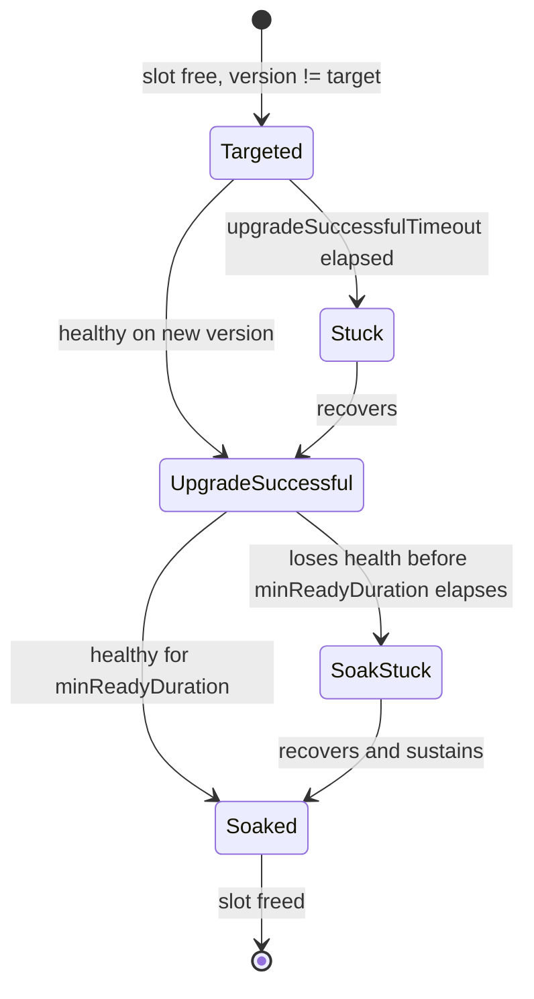
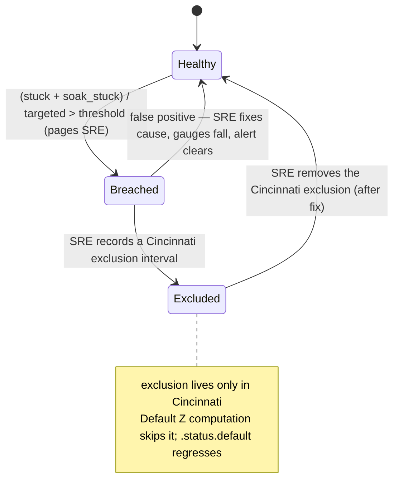

# ROSA V2 Cluster Upgrades

**Last Updated Date**: 2026-10-19

## Summary

ROSA V2 keeps every cluster in a region continuously upgraded to a per-channel "Default Z," computed from Cincinnati Z-release risk and a day-offset for progressive delivery, with CI coverage sourced from the live fleet's actual active z-release spread rather than per-cluster CVO risk evaluation or live Cincinnati graph-edge checks.

## Context

- **Problem Statement:** The fleet needs an automatic, low-touch way to keep a large, regionally-distributed set of clusters on safe, continuously-updated OCP Z/Y releases, catch regressions quickly, and give SRE controlled escape hatches, without centralized coordination across regions or per-cluster CVO-reported risk evaluation.
- **Constraints:** This design is bounded by OCP's current delivery model — OCP ships as a single monolithic release payload, so the platform cannot patch individual components; every fix (CVE, bug, or platform issue) arrives only as a whole Z-release and only after OCP's full release cycle completes. The machinery here is therefore built around whole-payload Z/Y transitions, not component-level patching. Beyond that: each region's Channel and Upgrade controllers (introduced in this document) operate independently (Regional Independence); the platform does not evaluate CVO-reported per-cluster risk; rollout must be progressive and staggered, not instantaneous; SRE overrides must go through ZOA TAs (Zero-operator-access Trusted Actions), not direct cluster access; EOL migration must reuse the same machinery as ordinary upgrades rather than a separate path.
- **Assumptions:** OCP's own nightly/candidate/stable release pipeline is a trustworthy signal that a Z-release has been vetted; platform-specific risk exclusions can already be declared today as regex-matched `from` entries in Cincinnati's `blocked-edges` graph-data, and the [Targeted Update Edge Blocking](https://github.com/openshift/enhancements/blob/master/enhancements/update/targeted-update-edge-blocking.md#fleet) enhancement's `Fleet`-scoped `matchingRules` (targeted OCP Q1 2027) will let those exclusions be scoped to the ROSA-HCP fleet specifically, instead of blocking every cluster on the affected version.

## Alternatives Considered

1. **Use CVO for per-cluster edge checking:** evaluate each cluster's own CVO-reported risks and graph edges before every upgrade decision. Rejected per the rationale in the [Alternative Spec for Managed Fleet z-stream selection](https://docs.google.com/document/d/1wYr-MW_r0i_tftD9rNM0HIfuU_BcbqUghdZno6F5yYM/edit?tab=t.0) document.
2. **Let customers select which Z to run:** expose Z-level choice directly to customers, not just channel/Y-level choice. Rejected because it fragments the fleet's active-version spread too much for CI to cover: Testing Requirements' live-fleet-sourced coverage model depends on the active spread staying narrow enough to fully test.
3. **Let customers opt into early Z-upgrades:** give customers a lever to adopt a new Z ahead of their channel's normal day-offset. Rejected as unnecessary: the design already keeps the whole fleet upgraded to Default Z almost continuously, so there's no meaningful "early" case left to expose.

## Design Rationale

- **Justification:** Deriving CI coverage from the live fleet (rather than live Cincinnati graph-edge checks or per-cluster CVO risk evaluation) means every version a customer could actually be on has already been proven to cross into the next target before that target is ever reached, with no runtime dependency on an external graph API.
- **Evidence:** Querying Cincinnati's real graph data (see Y+1 Upgrade) showed that cross-minor edges are anchored to whatever X.Y+1.Z was latest at the time X.Y.Z was promoted — matching OCP's own process of testing upgradability "from X.Y.Z to the latest X.Y+1.Z" at promotion time; not to whatever our channel's Z-offset and day-offset currently resolve as Default Z. A literal edge-check against Default Z would therefore be brittle; the live-fleet-sourced model avoids that dependency entirely.
- **Comparison:** CVO-based per-cluster edge checking (alternative 1) would require the per-cluster risk evaluation this design explicitly avoids, for the reasons in the linked design notes. Customer-selectable Z (alternative 2) and early-upgrade opt-in (alternative 3) would both work against the fleet-wide CI coverage model this design depends on, for no corresponding benefit once the whole fleet is kept close to Default Z continuously.

## Consequences

### Positive

- No per-cluster CVO risk evaluation is needed; safety comes from CI coverage sourced from the live fleet instead.
- The fleet stays close to Default Z almost continuously, so there's little practical "drift" for the design to account for.
- SRE retains fine-grained override (pin, rollback, channel override, fleet-wide exclusion) entirely through ZOA Trusted Actions, with no direct cluster access.
- EOL migration reuses the same channel-targeting machinery as ordinary upgrades (see [Block 6](#block-6---eol)), including the EUS multi-minor hop (see [Block 2](#block-2---upgrade-controller), User-driven Y-upgrade), rather than a separate forced-upgrade path.

### Negative

- The SLO breach alert's sensitivity decays over a version's lifetime as successful upgrades accumulate (see Risks); mitigated by bounding the ratio to a trailing window instead of each version's lifetime, not yet implemented.
- Pinning a cluster is not free: every distinct pinned version is a standing entry in the CI test matrix for as long as the pin exists (see [Block 2](#block-2---upgrade-controller), Per-cluster pin).
- Platform-specific risk exclusions are version-scoped, not fleet-scoped: an SRE-written Cincinnati `blocked-edges` entry (regex on `from`), prompted by the SLO breach alert, blocks the Z for every cluster on that version, not just ROSA-HCP. Automating that write to remove the manual SRE step is a separate seaplane-side target end state; narrowing the block to just the ROSA-HCP fleet awaits the `Fleet` condition type from the [Targeted Update Edge Blocking](https://github.com/openshift/enhancements/blob/master/enhancements/update/targeted-update-edge-blocking.md#fleet) enhancement, targeted for OCP Q1 2027.

## Cross-Cutting Concerns

### Reliability:

- **Observability:** see Monitoring & Observability Requirements and [Block 4](#block-4---metrics) for the full metrics set.
- **Resiliency:** see the SLO breach alert ([Block 3](#block-3---channel-controller)) and the Risks table for known gaps.

### Security:

- All per-cluster and Cincinnati-graph SRE overrides (pin, rollback, channel override, fleet-wide exclusion) go through ZOA Trusted Actions; rollback specifically requires a separate, higher-approval ZOA TA (see SRE Controls).
- The one exception is the fleet-wide `minVersion` hotfix floor (see Hotfixes), delivered through reviewed GitOps rather than a self-service ZOA TA: a fleet-wide floor is a deliberate, auditable change that warrants PR review.

## Resources

- [OCP Upgrade Graph](https://access.redhat.com/labs/ocpupgradegraph/update_path)
- [OCP Release Status](https://amd64.ocp.releases.ci.openshift.org/)
- [Alternative Spec for Managed Fleet z-stream selection](https://docs.google.com/document/d/1wYr-MW_r0i_tftD9rNM0HIfuU_BcbqUghdZno6F5yYM/edit?tab=t.0)

## Terminology

- **Channel:** The rollout stream that declares the minor version and stability tier (e.g., stable-4.22, fast-4.23).
- **Default Z (x.y.default-z):** The target z-stream for a given channel, i.e. the Channel CR's `.status.default`.
- **Limited Support (LS):** A support state a cluster can enter (for example when it needs customer action or runs in a configuration with reduced support guarantees). LS clusters are not exempt from automatic upgrades (see Automatic Z-upgrades).
- **Platform-specific risk exclusions:** Excluding a version via a Cincinnati `blocked-edges` entry with a regex match on `from` (e.g., "don't upgrade ROSA V2 to 4.22.17"), written by SRE and prompted by the Channel controller's SLO breach alert (see Automatic Z-upgrades), with pinned versions as a manual SRE escape hatch. This mechanism is available today, but blocks the version for every consumer of the graph, not just ROSA-HCP; the [Targeted Update Edge Blocking](https://github.com/openshift/enhancements/blob/master/enhancements/update/targeted-update-edge-blocking.md#fleet) enhancement's `Fleet`-scoped condition type (targeted OCP Q1 2027) will let exclusions be scoped to the ROSA-HCP fleet specifically.

## Design Principles

The platform will test upgrades from any active Z to any other Z within the same minor version. Safety comes from testing, not graph edges (no edge checking for z-stream jumps).

The goal is to stay close to current rather than waiting for long bake times, because extended delays (6-8 weeks) accumulate open CVEs. Safety comes from defense in depth via testing and progressive rollout, not from predicting all risks ahead of time.

The platform does **not** perform per-cluster CVO risk evaluation for Z-stream upgrades. CVO-reported cluster-specific risks are not factored into the automatic upgrade decision. Instead, the platform:

- Relies on CI testing to catch issues before rollout.
- Provides exclusions and pinned versions as an escape hatch for known exceptions.
- Will rely on the Cincinnati graph for platform-specific risk information (attached to z-releases).

### Default Z

The Default Z for a channel is governed by two independent offsets:

- **Z-offset (stability tier):** how many Z's back from the latest available Z the channel's Default Z sits, for bake-time/stability reasons. The offset is a control the platform owns and tunes per channel: a larger offset buys more soak time at the cost of carrying known CVEs and bug fixes longer, a smaller one trades soak time for fresher fixes, and we set each channel's value wherever that trade-off balances best, revising it as real-world data warrants. The values used in this document — stable/eus at 1 (latest minus one) and fast at 0 (the latest available Z), are starting points.
- **Day-offset (progressive delivery):** how many days a region waits after a Z's release date before adopting it as Default Z, so a new Z doesn't land on every region at once (see Cross-Region Promotion). This is a per-region setting, unrelated to channel stability tier.

In all cases, the chosen Z must have passed ROSA V2 CI and have no platform-specific risks declared against it in Cincinnati.

### Channels

The list of supported channels is obtained from the OCP Upgrade Graph plus an allowlist/blocklist ruleset defined through gitops.

Some channels might only be accessible under feature gates.

## Installation

The customer selects the channel (e.g., stable-4.21). The platform resolves the Default Z for that channel at installation time.

## Automatic Z-upgrades

The platform will keep the fleet continuously upgraded to the Default Z for their respective channels, ensuring that clusters are always running a version that has passed CI and has no known platform-specific risks.

Limited Support clusters are not exempt from this. Keeping them on the Default Z like every other cluster is what keeps them inside the active-version spread CI covers (see Testing Requirements); holding one back on an old Z would both widen the CI matrix and leave it unpatched. If a specific Limited Support cluster genuinely must hold a version, that is handled through the ordinary per-cluster pin (see Per-cluster pin in [Block 2](#block-2---upgrade-controller)), not a blanket Limited Support exemption.

### Progressive Rollout

Progressive rollout is per-region: each region drives its own clusters to the Default Z independently, with no central orchestration. The platform upgrades continuously, capped by `MAX_CONCURRENT_UPGRADES` (the number of in-flight upgrades across the region). A slot is held from the moment a cluster is targeted until it has fully soaked, so a broken Z that leaves clusters stuck naturally wedges the rollout instead of pouring more clusters into it.

A cluster must stay healthy for `minReadyDuration` after it first reports healthy on the new version before the upgrade counts as fully soaked and frees its slot.

The controller collects upgrade outcomes and uses them as its own feedback signal: when `(stuck + soak_stuck) / targeted` crosses the SLO threshold for a Z in a region, the Channel controller raises an alert that pages SRE (see SLO breach alert in [Block 3](#block-3---channel-controller)). Detection is regional, but there is no automatic local block. For a Z that leaves clusters stuck, the rollout self-wedges — stuck clusters hold their slots (see Progressive Rollout), capping concurrent exposure at `MAX_CONCURRENT_UPGRADES` while SRE investigates; for a Z that fails only partially or after soak, successful clusters free their slots and more are targeted, so exposure is bounded only by SRE response time (see Risks). SRE formalizes a genuinely bad Z as a Cincinnati exclusion interval (see Platform-Owned Risks) — the only exclusion path — which blocks that Z across all regions at once. Automating the breach alert to a Cincinnati graph-data write is the target end state.

### Cross-Region Promotion

Releases are staggered across regions through the Default Z determination itself, not through a central coordinator. Each region carries a day-offset and only treats a given Z as its Default Z once that Z has been released (out in the channel) for at least that many days (regions can be grouped so a first group leads and later groups follow). Because every region resolves its own Default Z independently, the fleet upgrades in a staggered fashion with no coordinator and no change to the per-region controller logic.

### Fleet Variance

Clusters may differ from x.y.default-z if:

- **Upgrade in progress:** Progressive rollout is mid-flight.
- **Pinned version**: SRE has pinned a cluster or group to a specific Z (via ZOA TA). This can put a cluster ahead of x.y.default-z as well as behind it.

### Monitoring & Rollback

- **Fleet visibility:** see Monitoring & Observability Requirements.
- **Rollback:** HyperShift supports rollback to a previous z-stream (not y-stream), never automated. The platform doesn't restrict `pin-version` to that boundary — it isn't validated against anything, regardless of minor (see Per-cluster pin) — so a rollback pin that crosses minors is on the SRE to understand and accept against HyperShift's own supported behavior; ZOA TA review is the safety mechanism, not software validation. An SRE rolls a cluster back by pinning it to an older Z, through a dedicated ZOA TA that requires additional approval (see SRE Controls).

## Y+1 Upgrade

The customer changes the channel (e.g., stable-4.21 → stable-4.22). The platform does not check Cincinnati edges for this: CI coverage is sourced from the live fleet (see Testing Requirements), so every z-release actually running in production has already been tested crossing into the target channel's Default Z before any customer requests the change. The platform rejects the change only if:

- admin acknowledgments have not been provided (policy gate, not risk evaluation)
- the change would create an N-3 control-plane skew
- the Default Z on the new Y has a defined platform-specific risk

Y+1 upgrades are validated via CI testing, not per-cluster CVO evaluation, and not via a live graph-edge check. Nightly and candidate testing continuously pull the fleet's actual active z-release spread for Y (across every region, including pinned clusters) and test upgrading each of those versions to both Y's Default Z and Y+1's Default Z. By the time a Z is promoted into a stable/fast/eus channel, every currently-active Y-side version has already been proven to cross into it, so a customer-requested Y+1 change never needs a runtime coverage check, only the risk/ack/skew gates above.

The platform does not perform per-cluster CVO risk evaluation for Y+1 upgrades. Safety comes from:

- CI testing sourced from the live fleet, covering every currently-active z-release's crossing into the target channel before that target ever becomes a channel's Default Z.
- Progressive rollout.
- Monitoring and rollback capability.
- Platform-specific risks in the graph (fleet-wide blocks).

## SRE Controls

SRE can perform the following controls:

<!-- prettier-ignore -->
| Control | Scope | Mechanism | Use Case |
| --- | --- | --- | --- |
| Z-release Exclusion intervals\*  (e.g. `[4.22.14, 4.22.18)`) | Fleet wide | Cincinnati Graph Data | A release fails CI, or progressive upgrades start failing |
| Channel `minVersion` floor (fleet-wide hotfix) | Fleet wide | GitOps (Channel CR) | A critical fix (e.g. CVE) must reach the whole fleet faster than the normal cadence (see Hotfixes) |
| Override the channel (forces a Y-stream change) | Cluster specific | ZOA TA | Forced upgrade (e.g. EOL) |
| Pin to a specific Z at or above the cluster's current version   (SRE must remove the pin for future upgrades.) | Cluster specific | ZOA TA | The cluster must stay at a particular z-release for special reasons or due to its special configuration |
| Pin to a specific Z below the cluster's current version (rollback)   (SRE must remove the pin for future upgrades.) | Cluster specific | ZOA TA, separate from the one above and requiring additional approval | SRE determines the cluster's version must be rolled back |

\* Note that exclusion intervals apply to all channels: a blocked z-release is unavailable for installation and as an upgrade target across every channel.

## Hotfixes

A hotfix is the case where a fix, typically a critical CVE or a critical bug, must reach clusters faster than the normal Default-Z cadence would deliver it. Because OCP ships as a whole release payload (see Context, Constraints), a hotfix is always a jump to a newer Z that carries the fix, never a component-level patch. There are two hotfix paths, differing only in blast radius:

- **Fleet-wide hotfix (`minVersion`):** a per region GitOps-delivered floor on a channel's Default Z (see [Block 3](#block-3---channel-controller)). When set, Default Z computation raises `.status.default` to the lowest eligible Z at or above `minVersion` (and leaves it unchanged if the normal Default Z is already higher), overriding the Z-offset and the day-offset's automatic aging. Because `minVersion` is itself delivered per region via GitOps, SRE still controls the cross-region rollout and can stagger it like any other release. The usual safety filters still apply above the floor: `minVersion` must resolve to a CI-passed, non-excluded Z, and the actual rollout is still paced by `MAX_CONCURRENT_UPGRADES`. Once the fleet has climbed to the new floor, normal progression resumes from there.
- **Cluster-specific hotfix (pin):** the per-cluster pin already described (see Per-cluster pin in [Block 2](#block-2---upgrade-controller) and SRE Controls). SRE pins a single cluster forward to the fixed z-release through a ZOA TA, without moving the rest of the fleet.

`minVersion` is reserved for genuinely urgent fixes, not routine floor-raising. Clusters held below `minVersion` by a pin are the exception the floor does not reach: `minVersion` governs Default-Z-driven clusters, so SRE must reconcile any pinned cluster that also needs the fix through the cluster-specific path above.

## Testing Requirements

Testing is the primary validation mechanism for both Z-stream and Y-stream upgrades. The goal is not to run the full OCP conformance suite, but to validate "the glue that manages our service" works across versions. Nightly testing provides 24h feedback for early detection and fast revert requests to OCP.

### Coverage

Platform must maintain automated test coverage for:

- **Installation:** Every supported z-release for all supported channels.
- **Z-stream upgrade:** every z-release currently active in the fleet, across all regions (including pinned clusters), upgraded to its minor's Default Z (validates the "any Z to any Z" assumption using live fleet state, not a fixed version matrix).
- **Y-stream upgrade:** every z-release currently active in the fleet for minor Y, across all regions (including pinned clusters), upgraded to Y+1's Default Z. Sourcing this from live production, rather than a static graph walk, is what lets a Y+1 channel change skip any runtime edge check (see Y+1 Upgrade): coverage already exists for every version a customer could actually be on. Every distinct version an SRE pins a cluster to is still live in production, so it adds a standing entry to this matrix for as long as the pin exists (see Per-cluster pin in [Block 2](#block-2---upgrade-controller)). Pinning is not free from a CI-cost perspective.
- **Feature validation:** Core platform features (ingress, node creation, KMS, HSM, storage, etc.).

### CI Testing configurations

1. **Nightly testing (\~24h feedback):** Platform runs automated tests against **accepted** OCP nightly builds. Breakage triggers immediate revert request to OCP (must be within 24h; OCP will revert without argument if caught early).
   1. ROSA V2 e2e tests
   2. Upgrade tests: every z-release currently active in the fleet (across all regions, including pinned clusters) to the nightly build.
2. **Candidate testing:** Pre-release versions vetted before entering fast/stable channels.
   1. ROSA V2 e2e tests
   2. Upgrade tests: every z-release currently active in the fleet for the same minor (across all regions, including pinned clusters) to the candidate release.
   3. Y+1 upgrade tests: every z-release currently active in the fleet for the prior minor Y (across all regions, including pinned clusters) to the candidate release, when the candidate is a Y+1 target. This is what proves Y+1 coverage before the release is ever promoted, so no cluster is ever asked to cross an untested edge.

CI testing will not run on fast, stable or eus channels, as the release will have been vetted through nightly and candidate testing by that point. However, the platform will monitor the installs and upgrades on new releases, and in the case of failures or regressions, it will trigger alerts that will result in adding exclusion intervals for the affected z-releases.

### Upgrade tests:

- 1\. Install current z, and wait for ready
- 2\. Deploy custom workload
- 3\. Upgrade to new z
- 4\. Run ROSA V2 e2e tests and verify custom workload.

## Platform-Owned Risks

Requirement: As a platform provider, we must be able to add platform-owned risk rules for z-releases to the Cincinnati graph.

- **Scope:** Platform-wide (not per-cluster). Example: "Don't install or upgrade ROSA V2 clusters to 4.22.17 on AWS due to issue X."
- **Fallback:** Until platform-specific graph support is available, the SLO breach alert handles automatic detection and SRE records the block as a Cincinnati exclusion interval; process-driven risk reporting plus pinned versions remain a manual SRE escape hatch.

## Monitoring & Observability Requirements

- **Fleet Z-stream distribution:** Track percentage of fleet on default-z, lag distribution by version, reasons for lag (pinned, upgrade in progress, stuck, soak-stuck).
- **Upgrade success metrics:** Track upgrade success rate, time-to-rollout, SLO breach correlation with upgrades.
- **Pinned z-releases:** Expose which specific z-releases are currently pinned fleet-wide, labeled by version (not just a count). CI consumes this feed directly to decide what it does and doesn't need to keep testing for a given version. The platform doesn't need its own lever or policy for "stop testing a stale pin"; that decision lives entirely on the CI side, informed by this metric.
- **Hotfix floor compliance:** During a fleet-wide hotfix, track how much of the fleet is at or above the channel's `minVersion`, and time-to-full-compliance, so a CVE remediation can be reported against an SLA. This joins `seaplane_cluster_version` against `seaplane_channel_min_version`, the same way the Default Z distribution does.

## Risks

<!-- prettier-ignore -->
| Risk | Description | Mitigation |
| --- | --- | --- |
| Risk is declared and the z-default goes back one release (fallback z). | The fleet will now upgrade to the fallback z, which has not been the testing target since the release of the latest z. This is a narrow risk, because CI has previously tested the fallback z. | Test against latest z **and** the fallback z. Alternatively, all upgrades are stopped, tests are launched against previous-z and after success upgrades are resumed. NOTE: we will not opt to do this initially. |
| The SLO breach alert ratio's denominator decays in sensitivity over a version's lifetime. | `targeted` is never withdrawn (lifetime count for the version), while `stuck`/`soak_stuck` are withdrawn once a cluster recovers. As a version accumulates successful upgrades over time, the same absolute number of new failures represents a shrinking percentage, so the alert becomes progressively less likely to fire on a later bad rollout of the same version. | Bound the ratio to a trailing window instead of each version's lifetime: count distinct clusters that were stuck or soak-stuck at any point in the window (not just right now, so one that already recovered within the window still counts), divided by how many clusters were newly targeted in that same window. `targeted` is already a monotonic count, so the windowed denominator falls out of it directly; no new metric is needed. Not implemented initially, same as the missing minimum-sample floor (see SLO breach alert in [Block 3](#block-3---channel-controller)). |
| The interim exposure window between detecting a bad Z (SLO breach alert, or post-promotion monitoring) and SRE recording a Cincinnati exclusion is no longer closed automatically. | With no local exclusion latch, nothing pulls `.status.default` off a bad Z until SRE writes the Cincinnati exclusion. Self-wedging bounds exposure only for the stuck/soak-stuck failure modes the SLO ratio detects; a Z that fails partially or only after soak frees slots as clusters succeed, so the eligible fleet can keep cycling onto it during the SRE response window. | Accepted trade-off of making Cincinnati the single exclusion store. Bounded in practice by SRE paging response, and for post-soak regressions by post-promotion monitoring (see Testing Requirements). Automating the breach-to-Cincinnati write (target end state) closes the window without reintroducing a second exclusion store. |
| Upgrade status conditions grow unbounded | For every upgrade, each cluster gains two .status.conditions with no cleanup | Implement a cleanup mechanism to remove or archive old conditions, or limit the number of retained conditions per cluster. |

## Implementation plan

This section contains the implementation details for this feature. It is not necessary to read this to understand the high-level design or the risks and requirements outlined above.

### Block 1 - API and Channel CRD

Channel CRs are Postgres-backed custom resources (not Kubernetes-native), stored under `channels`. A channel is named for its OCP minor and group, e.g. `stable-4.20`. Channel CRs are per-region: each region's Channel controller owns its own copy of a given channel, so the same channel name can resolve to a different `.status.default` in different regions once the day-offset is applied (see [Block 3](#block-3---channel-controller)).

- `.spec.feature_gates[]`: the feature gates that unlock the channel for customer selection. Empty or unset means the channel is available to all customers.
- `.spec.minVersion`: (optional) GitOps-delivered floor on the channel's Default Z, used for fleet-wide hotfixes (see Hotfixes). Empty or unset means no floor.
- `.status.default`: the Default Z (version and release image) the channel currently installs and upgrades to, e.g. `4.20.13`; the Channel controller resolves the image from Cincinnati and sets it.

Cluster creation API and validation:

- Expose a channel field in `ClusterSpec`.
- Synchronous validation when a user sets the channel: the channel must exist and its feature gates must be satisfied.
- New API endpoint to list the available channels.
- Surface the current z-version in each Cluster's `.status`.

Install: at install time the platform resolves the channel's `.status.default` and deploys its release image.

#### Internal use case

- Feature gate marker for a `spec.release.image` override: an unvalidated pass-through to OCP, gated to entitled non-prod users, never reachable by external customers.
- Feature gate to access `private` channels (enforced by the validation above).
- Feature gate for the ability to disable upgrades: if set, the upgrade controller does not upgrade the cluster.
- Feature gate to set `pin-version` at cluster creation, so a cluster can install directly at a chosen Z instead of the channel's Default Z (see Per-cluster pin in [Block 2](#block-2---upgrade-controller)).

### Block 2 - Upgrade controller

Scope: drive every cluster to its channel's `.status.default` (automatic Z-upgrades), and execute user-driven Y-upgrades (channel change). The target release (version and image) is already computed in `.status.default` by the Channel controller.

Reconcile loop (every ~10 min):

- A cluster's target is its `pin-version` label when present (see Per-cluster pin), otherwise `.status.default`. Pin is the only path allowed to move a cluster backward; targeting via `.status.default` is never a downgrade.
- A cluster is eligible for a new target when it is not currently in-flight and its version differs from this target. An in-flight cluster is skipped here even if `.status.default` has since advanced past it, or a Cincinnati exclusion has invalidated its target: the automatic Default-Z path never retargets a cluster mid-upgrade, only re-evaluates it once its current attempt finishes. An SRE pin is the only thing that can move a cluster off its target before then (see Per-cluster pin, Remediation).
- Staggering: `MAX_CONCURRENT_UPGRADES` caps in-flight upgrades, pin-driven or automatic alike. A cluster counts as in-flight from the moment its `TargetedForUpgrade` condition is set until its `UpgradeSuccessfulSoak` condition matches that same recorded release, so the count survives controller restarts. Pick up a new cluster only while in-flight is under the cap. When more clusters are eligible than free slots: clusters still mid-walk through an EUS intermediate hop (see User-driven Y-upgrade) are picked up first, ahead of everything else, since they've already been admitted into a channel they're not meant to stay on; among the rest, the ones furthest behind their target go next, so a cluster that's fallen several Z's behind doesn't keep losing slot contention to ones that just became eligible.

Per-cluster lifecycle (the slot is held against the recorded target release from target until full soak, even if `.status.default` advances to a newer Z — or that target gets excluded in Cincinnati — while the upgrade is in flight: the automatic path always lets a cluster finish the upgrade it was targeted for; only an explicit SRE pin can move it off that target sooner, see Remediation):

- Target: set the `TargetedForUpgrade` condition (release and timestamp), set `.spec.release.image` from the cluster's target. `seaplane_channel_upgrades_started{channel,version}` is emitted from the presence of this condition and is never removed.
- `UpgradeSuccessful` status condition: the cluster reports healthy on the new version.
- `UpgradeSuccessfulSoak` status condition: the cluster has stayed healthy for `minReadyDuration` (clock starts at `UpgradeSuccessful`). At this point the cluster is fully upgraded and frees its slot.

`stuck` and `soak_stuck` are not independent state the controller sets and must remember to unset. Each reconcile, the controller already knows (from the `TargetedForUpgrade`/`UpgradeSuccessful` timestamps) whether a cluster has blown through its timeout, so it recomputes the comparison and emits or withholds the metric fresh every loop. The metric's appearance fires the alert immediately (the timeout is already applied in the controller's comparison, so no `for:` duration is needed in the alerting rule); once the cluster succeeds or soaks, the controller simply stops emitting it next loop and the alert resolves:

- `seaplane_channel_upgrades_stuck{channel,version,uuid}`: emitted while a cluster is targeted at a release and has not reported `UpgradeSuccessful` for it within `upgradeSuccessfulTimeout` of the `TargetedForUpgrade` timestamp; withdrawn once it succeeds. Pages SRE.
- `seaplane_channel_upgrades_soak_stuck{channel,version,uuid}`: emitted while a cluster has reported `UpgradeSuccessful` for a release but lost health again before reaching `minReadyDuration` since that timestamp, without yet reaching `UpgradeSuccessfulSoak`; withdrawn once it soaks. Pages SRE.

Metric cardinality: `targeted` is labeled `{channel,version}` only, because every cluster is targeted and per-cluster series would be too many. `stuck` and `soak_stuck` carry `uuid` because we expect few and need to name the offending clusters.

`stuck` and `soak_stuck` only cover a cluster that's already been targeted and is failing to land, not a cluster sitting untargeted (ahead of `.status.default` after a Cincinnati exclusion drops the default, or a deliberate pin, or behind it because `MAX_CONCURRENT_UPGRADES` hasn't picked it up yet). `seaplane_cluster_version{channel,version}` counts clusters per channel and version, recomputed each reconcile: this is the region's own equivalent of Telemeter's `cluster_version`, giving Fleet Z-release distribution a regional-native source that doesn't depend on an external pipeline. `seaplane_channel_default_version{channel,version}` marks which version is currently `.status.default` for that channel, so the two can be joined to see the fleet's distribution against the target. Stranded clusters (ahead or behind Default Z for longer than the expected rollout window) are visible in that distribution, but there's no dedicated alert for it: once a cluster is accounted for by `stuck`/`soak_stuck` or the SLO breach alert, there's nothing further for SRE to act on.

Remediation (no automatic rollback):

- Stuck and soak-stuck clusters hold their slots: excluding the bad Z in Cincinnati stops new clusters from being targeted at it, but it does not by itself move an already-stuck cluster off it — the automatic path never retargets a cluster mid-upgrade. SRE either fixes the cluster in place until it soaks on the original target, or pins it to a different `<z>` through the rollback/forward ZOA TA (see Per-cluster pin) to move it off the bad Z explicitly.
- HyperShift supports rollback, but the controller never downgrades automatically. An SRE performs a rollback by pinning the cluster to an older `<z>` (see Per-cluster pin), through the dedicated rollback ZOA TA.

Per-cluster pin: SRE pins a cluster via a label on the Cluster, set through a ZOA TA:

- `seaplane.io/pin-version: <z>`: replaces `.status.default` as the cluster's target, regardless of what `.status.default` is. The reconcile loop drives the cluster to `<z>` through the normal Target → UpgradeSuccessful → UpgradeSuccessfulSoak lifecycle, the same conditions and metrics as any other upgrade. Two separate ZOA TAs set this label, not one: pinning to `<z>` at or above the cluster's current version is the ordinary action; pinning to a `<z>` below it is a rollback and goes through a separate ZOA TA requiring additional SRE approval (see SRE Controls). `<z>` isn't validated against anything: whatever value is set, the controller applies it directly, in one step, regardless of minor. ZOA TA review is the safety mechanism, not software validation.
- SRE removes the label to resume automatic upgrades. A label (rather than a spec field) keeps this a simple, selector-friendly mechanism: SRE tooling and the "clusters pinned z releases" metric can both list affected clusters with a label selector instead of scanning cluster status.
- Cost: pinning is not free. A pinned cluster is still live in production, so its version is part of the active z-release spread that Testing Requirements sources CI coverage from: every distinct `<z>` a cluster is pinned at becomes a standing entry in the nightly/candidate test matrix for as long as the label exists. Pinning several clusters at different versions multiplies that matrix; SRE should keep pins rare, temporary, and consolidated (prefer pinning multiple clusters at the same `<z>` over scattering them across different ones).
- `seaplane_cluster_pinned{version}`: emitted per distinct version currently named by a `pin-version` label somewhere in the fleet. Labeled by version, not cluster, since the point is to tell external CI what versions are still pinned in production, not to enumerate clusters; CI decides for itself whether and how long to keep testing a given version.
- `seaplane_cluster_pin_active{uuid,channel}`: emitted per pinned cluster, by uuid. Always firing while the label is present, routed silently (visible, no page) by default; promoted to paging once the cluster's channel has an EOL date scheduled (see [Block 6](#block-6---eol)), since a pinned cluster can't climb to a dying minor's Default Z or follow the forced flip on its own.

User-driven Y-upgrade (channel change). The same-minor hop is always allowed. A minor change `x.y.z -> x.y+1.z'` is not graph-checked: Testing Requirements already guarantees every currently-active Y-side z-release has CI-proven coverage crossing into Y+1's `.status.default` before that `.status.default` is ever set, so there is nothing left to validate against Cincinnati at request time. Reject the change if:

- the Default Z on the target channel has a defined platform-specific risk;
- required admin acknowledgments have not been provided;
- the change would create an N-3 control-plane skew.

`.spec.channel` is the same mutable field either way: the customer sets it directly through the API (subject to the checks above), or SRE sets it on their behalf through the "override the channel" ZOA TA (see SRE Controls).

EUS multi-minor hop: a channel change can span two minors when the target is an EUS channel (e.g. `x.y-eus -> x.y+2-eus`), since EUS only lets worker nodes skip the intermediate minor's reboot, not the control plane (see [Block 6](#block-6---eol)). `.spec.channel` is set directly to the real final target and is never rewritten by the controller. Admission is synchronous and checks both legs up front: the reject conditions above are evaluated against the intermediate channel's (`x.y+1-<channelgroup>`) Default Z as well as the final channel's, since a partial walk that got stuck on an inadmissible intermediate hop would strand the cluster. Once admitted, no further gate-checking happens during the walk: each reconcile, the controller compares `.spec.channel`'s minor to the cluster's current minor; if the gap is more than one minor, the immediate target is the intermediate channel's Default Z instead of `.spec.channel`'s own, recomputed fresh every time rather than tracked as separate state. Once the cluster lands on the intermediate minor, the gap is one and the walk finishes as an ordinary single-hop Y-upgrade. If a new risk gets declared on the intermediate channel's Default Z mid-walk, Default Z computation ([Block 3](#block-3---channel-controller)) already filters it out before the cluster arrives, the same as any automatic climb.

Status:

- Surface the channels (and target Z) the cluster can move to.

Configuration:

- `MAX_CONCURRENT_UPGRADES`: maximum clusters upgrading at once.
- `minReadyDuration`: how long a cluster must stay healthy on the new version to count as soaked.
- `upgradeSuccessfulTimeout`: grace period before a cluster that has not reported healthy on the new version is counted stuck.

Conditions (on the Cluster). Each condition records the release it refers to, so the controller evaluates progress by matching the condition's release against the cluster's current target (no destructive reset on retarget; the per-version metrics follow the same release label):

- `TargetedForUpgrade`: the release the cluster was targeted at, and when; always present once an upgrade has started.
- `UpgradeSuccessful`: the release the cluster last reported healthy on.
- `UpgradeSuccessfulSoak`: the release the cluster has sustained health on for `minReadyDuration`.

Monitoring:

- Alert if a cluster's target (`pin-version` or `.status.default`) cannot be resolved to a valid release image for a period of time. This is a distinct failure mode from `stuck`/`soak_stuck`: it happens before `TargetedForUpgrade` is ever set, so neither of those metrics would catch it.

Testing:

- Integration tests run against the local Postgres and DynamoDB container interfaces (no LocalStack).
- Stub the Cincinnati and sippy clients. Drive the controller by editing Channel objects and cluster state, inject stuck and soak-stuck failures, and assert on the conditions, the emitted metrics, and what the controller writes to DynamoDB.

### Block 3 - Channel controller

Scope: own the Channel CRs and compute each channel's `.status.default`.

Channel discovery:

- GitOps provides a list of rulesets that define what channels are supported (plain names or regexes), matched against channel names in the OCP Upgrade Graph (Cincinnati). Allow-list only those channels.
- For each supported channel, create and maintain a Channel CR, assigning `.spec.feature_gates[]` by the GitOps rules.

Default Z computation:

- Query Cincinnati (and sippy for nightlies) for new-Z discovery and Z release risks (future state); set `.status.default` to the Default Z (version and image) in the channel. No edge data is needed here or anywhere in [Block 2](#block-2---upgrade-controller): Y+1 crossings are validated by CI coverage sourced from the live fleet, not by querying Cincinnati's graph (see Y+1 Upgrade).
- The same-minor decision is deliberately simple: take the latest Z in the channel, back off by the channel's Z-offset (a stability-tier setting the platform tunes per channel; e.g. stable/eus = 1, fast = 0, illustrative), then walk further back past any Z that fails either filter:
  - skip any Z excluded in Cincinnati (platform-specific Z release risks or SRE-written exclusion intervals);
  - skip any Z that has not yet been out for the region's day-offset (a per-region delay delivered by GitOps, measured from the Z's release date). Staggering this offset across regions produces cross-region progressive rollout: a Z becomes the default in leading regions first and in trailing regions only once it has aged enough.
- Apply the `minVersion` floor (fleet-wide hotfix, see Hotfixes): if `.spec.minVersion` is set and the Z selected above is below it, raise the target to the lowest eligible (CI-passed, non-excluded) Z at or above `minVersion`, ignoring the Z-offset and day-offset for the purpose of meeting the floor. If no eligible Z at or above the floor exists, the channel has no valid Default Z and the controller alerts SRE (the same conflict shape as the EOL exclusion collision in [Block 6](#block-6---eol)).
- `seaplane_channel_default_version{channel,version}`: set to 1 for the version currently in `.status.default`, updated whenever it changes. Exists purely so `seaplane_cluster_version` ([Block 2](#block-2---upgrade-controller)) can be joined against it, without having to query the Channel CR directly.

SLO breach alert:

- Watch `seaplane_channel_upgrades_started`, `seaplane_channel_upgrades_stuck`, and `seaplane_channel_upgrades_soak_stuck`. When `(stuck + soak_stuck) / targeted > threshold` for a (channel, version), fire an alert that pages SRE. The controller takes no automatic action on `.status.default` and writes no exclusion of its own: Cincinnati is the only exclusion store (see Default Z computation above). Containment in the meantime comes from the rollout self-wedging — stuck clusters hold their slots (see Progressive Rollout), which caps concurrent exposure at `MAX_CONCURRENT_UPGRADES` only for a Z that leaves clusters stuck; a Z that fails partially or only after soak frees slots as clusters succeed, so its exposure is bounded by SRE response time instead (see Risks). There is no minimum-sample floor for now: a single early failure can trip the threshold and page (a floor is a future refinement).
- SRE resolves the alert one of two ways:
  - the Z is genuinely bad: record a Cincinnati exclusion interval for it (the only exclusion path). Default Z computation re-runs from scratch every reconcile, so once Cincinnati reports the exclusion `.status.default` regresses to the previous eligible Z and the `minVersion` floor is re-applied on top. If the excluded version was itself the hotfix floor and no eligible Z at or above `minVersion` remains, computation has no valid target and raises the "no eligible Z above floor" alert rather than silently dropping below the floor;
  - it was a false positive (for example one unhealthy MC): fix the underlying cause so the gauges fall and the alert clears.
- The Cincinnati exclusion is latched the same way any graph-data exclusion is: it persists until SRE removes it (after the fix), and while it stands the Z is never reconsidered for upgrades. Automating the breach alert to a Cincinnati graph-data write is the target end state; until then that write is the SRE step above.

Configuration: `threshold` (the SLO ratio that fires the breach alert), the per-channel Z-offset (stability tier), the per-region day-offset (progressive delivery), and the optional per-channel `minVersion` floor (fleet-wide hotfix, see Hotfixes), all GitOps-delivered.

### Block 4 - Metrics

<!-- prettier-ignore -->
| Metric | Requirement | Exposed by | Calculation |
| --- | --- | --- | --- |
| Telemeter `cluster_version` | Fleet Z-release distribution | CVO, via HyperShift's control-plane ServiceMonitor | CVO-reported actual/desired/updating/completed version per cluster |
| `seaplane_channel_upgrades_started{channel,version}` | Upgrade success metrics | Upgrade controller ([Block 2](#block-2---upgrade-controller)) | Presence of the `TargetedForUpgrade` condition; set once, never withdrawn |
| `seaplane_channel_upgrades_stuck{channel,version,uuid}` | Upgrade success metrics | Upgrade controller ([Block 2](#block-2---upgrade-controller)) | Recomputed each reconcile: true while targeted at a release and `UpgradeSuccessful` hasn't landed within `upgradeSuccessfulTimeout` of the `TargetedForUpgrade` timestamp; withdrawn on success |
| `seaplane_channel_upgrades_soak_stuck{channel,version,uuid}` | Upgrade success metrics | Upgrade controller ([Block 2](#block-2---upgrade-controller)) | Recomputed each reconcile: true while `UpgradeSuccessful` has landed but health is lost again before `minReadyDuration` since that timestamp, with `UpgradeSuccessfulSoak` not yet reached; withdrawn on soak |
| `seaplane_cluster_version{channel,version}` | Fleet Z-release distribution | Upgrade controller ([Block 2](#block-2---upgrade-controller)) | Count of clusters per channel and version, recomputed each reconcile; the regional-native equivalent of Telemeter's `cluster_version` |
| `seaplane_channel_default_version{channel,version}` | Fleet Z-release distribution | Channel controller ([Block 3](#block-3---channel-controller)) | Set to 1 for the channel's current Default Z, updated whenever `.status.default` changes; joins against `seaplane_cluster_version` to show the fleet's distribution against the target |
| `seaplane_channel_min_version{channel,version}` | Hotfix floor compliance | Channel controller ([Block 3](#block-3---channel-controller)) | Set to 1 for the channel's current `minVersion` floor when one is set; joins against `seaplane_cluster_version` to show how much of the fleet has reached the hotfix floor |
| `seaplane_cluster_pinned{version}` | Pinned z-releases | Upgrade controller ([Block 2](#block-2---upgrade-controller)) | One series per distinct version currently named by a `pin-version` label anywhere in the fleet |
| `seaplane_channel_excluded_version{channel,version}` | Excluded-version visibility | Channel controller ([Block 3](#block-3---channel-controller)) | One series per version currently excluded in Cincinnati for the channel (Z release risks or exclusion intervals), as applied by Default Z computation |
| `seaplane_cluster_pin_active{uuid,channel}` | EOL pin escalation | Upgrade controller ([Block 2](#block-2---upgrade-controller)) | One series per pinned cluster; always firing, routed silently by default |
| `seaplane_channel_eol_scheduled{channel}` | EOL pin escalation | EOL controller ([Block 6](#block-6---eol)) | Set to 1 once `installsClosedDate` or `eolDate` is set on the channel; joined against `seaplane_cluster_pin_active` to promote that alert to paging |

### Block 5 - CI

Scope: implement the Testing Requirements coverage (install, Z-stream upgrade, Y-stream upgrade sourced from the live fleet) as an extension of the `rosa-hyperfleet-ephemeral-e2e` workflow (openshift/release), reusing `rosa-hyperfleet-resolve-ocp-image` for nightly/candidate payload resolution.

- Fleet discovery: a step, sibling to `resolve-ocp-image`, queries the Platform API for every z-release currently active for a given minor, across all regions, including pinned clusters.
- Controls: `pin-version`, settable at creation ([Block 1](#block-1---api-and-channel-crd)) and updatable afterward ([Block 2](#block-2---upgrade-controller)), drives every version transition in these tests. It installs the cluster directly at the chosen Z, and changing it later triggers an upgrade through the same Target → UpgradeSuccessful → UpgradeSuccessfulSoak lifecycle and metrics production uses.
- Upgrade step: after install, change `pin-version` to the second target release, wait for `UpgradeSuccessfulSoak`, then re-run the e2e suite against the upgraded cluster.
- One periodic per cadence (nightly, candidate), looping over the discovered active-Z list and reusing the provision/teardown steps per version; each version reports its own pass/fail so one bad pairing doesn't mask the rest.
- Candidate also tests the prior minor's active Z's crossing into the candidate release when it's a Y+1 target.

Depends on Blocks 1-3: the fleet discovery and upgrade steps both need the Channel CRD, Upgrade controller, and Channel controller live.

### Block 6 - EOL

This is not in scope for EP1.

Depends on notifications.

EOL is a platform-driven channel change on a schedule. The climb within a minor and the minor hop after the flip are both ordinary [Block 2](#block-2---upgrade-controller) behavior (drive to `.status.default`), so the only new pieces are two dates, the forced flip, and the customer comms.

Channel CRD dates (GitOps/Cincinnati-delivered):

- `installsClosedDate`: after this, [Block 1](#block-1---api-and-channel-crd) validation rejects new installs and customer selection of the channel. The CR still exists and still computes `.status.default`, so existing clusters keep climbing. This replaces the dropped `enabled` flag: "closed" is a date, not a boolean.
- `eolDate`: the minor's hard end-of-life. Every cluster must be off the minor before it; the EOL controller works backward from this with a notification lead time.

New EOL controller, per cluster on an EOL-approaching channel:

- Notify: message the customer the planned forced-upgrade dates ahead of `eolDate`. This is the dependency that blocks EOL.
- Climb (reuse [Block 2](#block-2---upgrade-controller)): no special handling; `.status.default` already pulls the cluster to the dying minor's Default Z, which is Y+1-crossable by construction once reached (see Y+1 Upgrade). There's no separate "jump-off" qualification to wait for.
- Flip: once on the dying minor's Default Z, write `.spec.channel` server-side to the real final target (`X.Y+1-<channelgroup>`, or `X.Y+2-eus` for EUS). The flip bypasses the [Block 2](#block-2---upgrade-controller) admin-acknowledgment gate (this is a forced move, not customer-initiated) but still respects the N-3 skew guard, checked for every leg the move requires.
- Hand back to [Block 2](#block-2---upgrade-controller): the same gap-aware targeting rule that handles a customer's EUS channel change (see [Block 2](#block-2---upgrade-controller), User-driven Y-upgrade) takes over from here, no EOL-specific handling needed. For a non-EUS flip this is a single ordinary hop. For EUS, `.spec.channel` already names `X.Y+2-eus` directly; the control plane still can't skip `X.Y+1` (EUS only lets worker nodes skip that reboot), so [Block 2](#block-2---upgrade-controller) targets the intermediate minor's Default Z first and the final channel's once the gap closes to one.

Exclusion collision: if Cincinnati excludes every remaining Z in the dying minor's channel, `.status.default` has no eligible target left and the cluster can no longer climb forward, stalling the migration before it ever reaches a flip-ready Z. This is correct safety (never force a cluster onto a known-bad Z, even under deadline pressure), but as `eolDate` nears the EOL controller must escalate to SRE with the conflict spelled out: fix the Z, clear the Cincinnati exclusion, or accept the risk via ZOA TA.

Pinned collision: a pinned cluster (see Per-cluster pin in [Block 2](#block-2---upgrade-controller)) has the same effect as an exclusion collision: it can't climb to the dying minor's Default Z or follow the forced flip on its own, and nothing drives it off the minor before `eolDate`. `seaplane_channel_eol_scheduled{channel}`, emitted by the EOL controller once `installsClosedDate` or `eolDate` is set on a channel, is what turns `seaplane_cluster_pin_active{uuid,channel}` ([Block 2](#block-2---upgrade-controller)) from a silent, always-on signal into a paging one: the pin itself isn't urgent on an ordinary channel, but the moment its channel is EOL-scheduled, SRE needs to walk that cluster forward manually well before the deadline, not discover it at `eolDate`.
