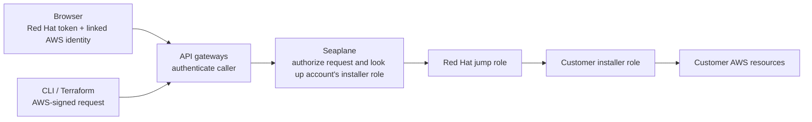

# Customer AWS access for Seaplane

**Date:** 2026-11-18  
**Status:** Proposed flow with open choices

## Overview

Every customer AWS account needs an installer role. An administrator prepares that role once, and Seaplane uses it for account-level AWS operations, such as fetching information for the UI, and for authorized cluster lifecycle work. Individual cluster creators do not create their own installer roles or copy role identifiers into requests.

The proposed flow has two kinds of access to establish: users need permission to operate on an AWS account, and Seaplane needs permission to enter that account through its installer role. The flow below explains both, from administrator setup through discovery and cluster creation.



Account setup registers the installer role, its assigned ExternalId, and the associated Red Hat organization; browser linking records the user's permitted AWS identities. Seaplane uses that setup information to resolve the installer role and ExternalId. Discovery and background cluster work share the same AWS access path.

## Creating the installer role & preparing the AWS account

An administrator runs:

```sh
rosa create account-roles
```

The administrator needs AWS permission to create or update the role and its policy attachments. Registering the account with Seaplane also requires Red Hat organization-admin authority or a defined ROSAAdmin role. ROSAAdmin does not exist today, so that delegation must be implemented before it can replace organization-admin authority.

Setup verifies the administrator's Red Hat authority and their authority over the target AWS account. This is an administrator-only setup requirement; ordinary CLI and Terraform use does not subsequently require a Red Hat login. An AWS-signed request identifies its AWS caller, but does not alone establish either Red Hat organization administration or unrestricted AWS administration.

The command obtains the approved configuration, creates the installer role if missing, or updates the intended compatible managed role. It attaches the existing installer managed policy and configures trust in the Red Hat jump role with a required, service-owned ExternalId. The ExternalId ties Seaplane's role assumption to the correct customer context.

Setup supports custom role prefixes, as in v1. The selected prefix determines the installer-role name, and setup registers the resulting ARN for automatic use. Re-running setup reuses the registered role and updates its approved trust/policy configuration.

### The CLI retrieves the approved configuration

ROSA's configured API address selects the Seaplane environment. A proposed read-only `GET /api/v0/installer-role-config` returns the environment's jump-role ARN or regional jump-role ARNs, installer managed-policy ARN, trust template/revision, and the account's expected ExternalId.

There is one installer-role configuration slot per customer AWS account per environment. A changed trust template or list of trusted regions updates that configuration and the existing role.

**Proposed: a service-generated ExternalId.** During authorized account setup, Seaplane generates one opaque, unique ExternalId per customer AWS account and environment and stores it with the account's access configuration. The CLI retrieves it through the configuration endpoint and configures the installer role's trust policy automatically.

**Alternative: use the Red Hat organization's external ID.** The installer role uses the owning Red Hat organization's external ID as its `sts:ExternalId`, following v1's OCM-role pattern. Seaplane resolves it from the account's registered organization, and the CLI configures the trust policy in the same way.

For either approach, repeated setup requests, including requests in other regions, return the same value. The service-generated value is assigned once and shared across regional services.

### Publishing the setup configuration

Extend the existing Platform API Helm chart with installer-role configuration: the environment's jump-role ARN (or AWS-region-to-ARN mapping), installer managed-policy ARN, and trust template/revision. GitOps deploys these values as a read-only configuration file mounted into the API pods through a ConfigMap. Platform API loads the file at startup and serves it through `GET /api/v0/installer-role-config`. Configuration changes trigger a rollout so the API loads the updated values.

**Alternative: a database-backed catalog following v1's startup-loader pattern.** Ship the same configuration with the deployment, but add a Platform API startup loader that reads it and inserts or updates dedicated catalog records in the service's existing PostgreSQL database. The configuration endpoint reads that catalog. GitOps deploys the configuration and rolls the application; the application loader performs the database writes, as Cluster Service does for its policy catalog. For Seaplane, the catalog would also include the jump-role mapping that v1 keeps in the CLI.

Both approaches use the existing deployment process to publish approved metadata. The choice is whether Platform API serves the loaded configuration directly or publishes it into a database catalog first. Customer-specific ExternalIds are stored separately in account access configuration, which the endpoint reads when assembling its response. Under the organization-ID alternative, it resolves the value from the account's registered organization instead.

Role setup also needs a catalog mapping Seaplane roles to their AWS-managed policy ARNs. The setup command reads this approved mapping and attaches the referenced policies to the roles it manages. Delivery through a metadata API, a shared SDK catalog, or both remains open; each uses the same approved setup definitions.

### The installer role trusts a Red Hat jump role

The proposed path uses one jump role per environment, shared by regional Seaplane services. The customer installer role trusts that ARN. Red Hat can then change regional workload identities without requiring every customer to edit their trust policy.

**Alternative: one jump role per AWS region per environment.** Each regional Seaplane service uses its region's jump role. The customer's installer-role trust policy lists the jump roles for the AWS regions it trusts. Setup would offer all supported AWS regions or a specific subset and allow that selection to be updated. This provides regional separation but requires additional trusted ARNs and trust-policy updates when enabling more regions. With one jump role per environment, the trust policy is shorter and enabling another AWS region does not add another trusted ARN.

## Storing the association between the customer account and the installer role

After setup, Seaplane must be able to resolve the installer role and expected ExternalId from the customer account alone. This information is needed before the first cluster exists, because the user may first ask to see VPCs or subnets.

The proposed approach registers an AWS access association at the account level: a dedicated resource representing the approved binding between the customer account and its installer-role configuration. Discovery requests use the authenticated account to find it; background workers use the stored owning account of the cluster or OIDC configuration. This approach has one association for the installer role per AWS account across regions within the environment. 

The role's AWS account must match the account Seaplane has authorized. ExternalId is an additional trust requirement, not a substitute for this ownership check. Role access is validated before setup is considered complete, and a partially configured account is reported as such. Each association records the assigned ExternalId and identifies the owning Red Hat organization. Supporting several organizations for one role requires explicit ownership and trust rules.

**Alternative: keep the v1 pattern of storing the association on each cluster.** Seaplane could populate role information on clusters automatically, and NodePools could resolve it through their parent cluster. This keeps background lookup close to the resource but repeats configuration and complicates role rotation. It also needs an account-level lookup or deterministic rule for discovery before a cluster exists; per-cluster storage alone cannot provide the entire flow.

**Another option: use a fixed role name instead of allowing custom prefixes.** Seaplane could construct the installer-role ARN from the AWS account ID and the fixed role name/path. This removes the need to store the role ARN either on each cluster or in an account-level access resource.

## Customer-supplied installer role ARN and externalId

The proposed API resolves the installer-role ARN and assigned ExternalId from the account's approved configuration. Customer-supplied payloads for cluster creation, discovery, and OIDC configuration omit both fields. This applies to every client: CLI, Terraform, browser, and direct API callers. Custom role prefixes remain an administrator choice during account setup. Customer-supplied installer role ARN and ExternalID would thus be unnecessary and would be removed.

**Alternative: accept optional installer-role fields in the API.** Clients could submit an installer-role ARN and ExternalId, validated against the account's approved configuration. CLI flags such as v1's `--role-arn` and `--external-id`, Terraform attributes, and other client inputs would expose that API capability. Seaplane would still resolve the values automatically when omitted. Allowing explicit input needs a compatibility justification and must preserve the approved role/account binding and assigned ExternalId.

## Browser identity connection

An installer role lets Seaplane perform AWS work, but does not establish which Red Hat users may request it. The proposed browser flow adds a separate **identity connection** between a Red Hat user and an AWS caller identity.

A user signs into Red Hat and runs:

```sh
rosa link account
```

The command uses the user's selected AWS credentials and Red Hat login. It wraps an API operation that verifies both identities and records their connection. It creates no new AWS role and grants no additional Seaplane permissions. One user can connect several AWS identities, and several users can independently connect the same permitted AWS role.

This is a one-time step for each connection, rather than a requirement on every browser login. The stored connection contains identity information, not the user's token or AWS credentials.

**Alternative: retain v1-style browser onboarding.** An administrator creates and links an OCM role in the AWS account to the Red Hat organization. Each browser user creates and links a user role in that account to their Red Hat login. The UI uses these organization and user-role associations to identify available AWS accounts and applies the user’s Red Hat permissions. This retains the existing OCM/user-role setup instead of introducing rosa link account and the new identity-linking API. Installer-role setup remains common to both approaches.

### Signing into the browser

Browser access requires a read-only API that accepts the user’s Red Hat token, identifies the signed-in user, and retrieves their saved AWS identity connections. It returns the AWS account ID and role or user ARN for each connection, giving the UI the information needed to populate an account/identity selector. This lookup uses the saved connections rather than querying AWS for accounts. The user selects an identity, and the UI includes it with subsequent requests.

These browser API calls pass through a proposed new API Gateway with a Lambda authorizer that the gateway invokes to check authentication before forwarding requests to Platform API. It validates the Red Hat token issued by the existing sign-in flow. The initial connection-list request requires only that token; subsequent account requests also require the authorizer to confirm that the selected AWS identity is linked to the user.

## Discovery API

The UI calls a discovery endpoint on the selected AWS region's API, such as `GET /api/v0/cloud_discovery/vpcs`, with the Red Hat token and saved AWS identity. The same gateway and Lambda authorizer used for the browser's connection-list request validate the token and, for discovery, also verify the selected AWS identity connection. If approved, the gateway forwards the request and verified identity information to Platform API. Platform API checks the caller's discovery permission, then uses the account ID to resolve the registered installer-role ARN and assigned ExternalId. It assumes the Red Hat jump role and then the customer installer role, builds an AWS SDK client with the temporary credentials, and queries AWS in the API's region. The API returns the results to the UI. The saved AWS identity authorizes the request; the installer role performs the AWS reads.

The account’s installer-role configuration can also be used by background cluster operations, including preflight checks and unmanaged OIDC key retrieval. These operations resolve access from the cluster or OIDC configuration’s owning account, using the same lookup and role-assumption mechanism as discovery.

## Maintaining and remove access

Re-running `rosa create account-roles` updates the approved compatible role, its trust configuration, and policy attachments as needed. Trust must require the approved jump-role principal or principals and the exact service-owned ExternalId.

Preserve v1's deletion safeguard: `rosa delete account-roles` refuses to delete a role referenced by an existing cluster. If Seaplane introduces an account-level access resource, apply the same principle to that resource: block its deletion while clusters or OIDC configurations depend on it.

User-access revocation and service-access revocation remain separate, as in v1. Removing a browser user's saved connection or permissions revokes that user's access after any authorization cache expires; existing clusters continue to use the account's installer role. Customers can also edit the installer role directly in AWS. As in v1, a trust change that prevents role assumption causes subsequent backend access attempts to fail and must be reported as an AWS access error.
