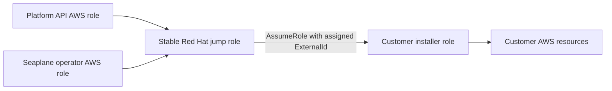

# V2 installer-role setup and account linking

**Date:** 2026-11-17  
**Status:** Proposed implementation design

## Purpose and scope

This design covers the foundation that lets Seaplane access a customer's AWS account and lets a customer use the browser with a Red Hat login. It builds on [the selected installer-role plan](https://github.com/jmelis/rosa-hyperfleet/blob/8c39705919b13a95c5084ee59c51cecd54132d7b/docs/design/preflight-and-ui-login-flows.md) and the scope agreed in the subsequent discussion.

## What the customer sets up

Two independent setup steps serve different purposes:

| Setup | What it establishes | Who needs it |
| --- | --- | --- |
| Create an installer role | Seaplane can perform the agreed AWS operations in the customer's account. | Accounts using features that require backend AWS access, regardless of client. |
| Link an AWS identity to a Red Hat user | That user can select the AWS identity when using the browser. | Browser users. Normal AWS-signed CLI and Terraform requests do not require it. |

There are also two different customer-side identities:

- **Caller identity:** the AWS user or role whose Seaplane permissions determine what the customer may do. A browser user selects a previously linked caller identity.
- **Installer role:** the role Seaplane assumes to perform work in AWS after authorizing the customer's request.

Linking a caller does not grant permission to create clusters, and knowing an installer-role ARN does not authorize its use. Existing Seaplane account admission and resource permissions continue to apply.

## 1. Create the installer role with account-roles

### Customer experience

Reuse the v1 `rosa create account-roles` command for v2. Initially, it creates only the installer role; support for the other account roles will be added later.

An AWS administrator runs:

```sh
rosa create account-roles --profile account-admin
```

The command:

1. Uses the selected AWS profile to identify the customer account.
2. Fetches the role configuration from the Seaplane API that ROSA is configured to use.
3. Shows the account, environment, and role to be created, then creates it with the existing installer managed policy, trust in the Red Hat jump role, and the required ExternalId.
4. Returns the installer-role ARN and ExternalId for cluster creation.

The administrator needs AWS permission to create the role and attach its policy, plus Seaplane account-setup permission. They can give the resulting identifiers to cluster creators or automation, who do not need role-creation privileges. No Red Hat login or browser linking is required for this setup.

If the role name already exists, the command stops without changing it and asks the administrator to choose another name. Updating or adopting existing roles is outside this delivery.

### How ROSA gets the correct jump role

**ROSA's configured API address selects the Seaplane environment; the AWS profile selects the customer account.** For example, a CLI configured for stage asks the stage API for its jump role, while a CLI configured for production asks the production API.

Infrastructure deployment supplies each environment's jump-role ARN to its API. ROSA retrieves it through a proposed `POST /api/v0/installer-role-config`, signed with the selected AWS credentials. The response contains:

- The stable Red Hat jump-role ARN for the environment.
- The existing installer managed-policy ARN and the trust template/version.
- The account's assigned ExternalId.

The API derives the customer account from the verified request and requires an account administrator or explicit setup permission. Retrieving this configuration does not grant cluster permissions.

**Proposed ExternalId ownership:** Seaplane generates and stores one unique value per customer AWS account and environment. Repeated setup requests, including requests in other regions, return the same value. Concurrent requests must not assign different values.

The ExternalId is not a credential, but customers cannot substitute their own value: the role's trust policy and Seaplane's later AWS calls must use the same assigned value.

## 2. Supply installer-role information when creating a cluster

### Customer experience

A cluster creator supplies the identifiers produced during setup:

```sh
rosa create cluster ... \
  --role-arn arn:aws:iam::123456789012:role/Seaplane-Installer \
  --external-id <service-assigned-value>
```

Retain v1's `--role-arn` and `--external-id` flags. Both values are required in v2, and the ExternalId must be the service-assigned value. Terraform and direct API clients supply the same information. No Red Hat token or account-linking call is required for AWS-signed cluster creation.

Use v1's `aws.sts.role_arn` and `aws.sts.external_id` field names inside the existing v2 `spec` envelope:

```json
{
  "spec": {
    "aws": {
      "sts": {
        "role_arn": "arn:aws:iam::123456789012:role/Seaplane-Installer",
        "external_id": "<service-assigned-value>"
      }
    }
  }
}
```

This is an excerpt; the request still includes the existing cluster settings. These are new fields in the v2 API. The API requires both, verifies that the role belongs to the authorized customer account, and checks that the ExternalId equals the service-assigned value. Existing request authorization runs before account configuration is disclosed or used.

The role information is stored with the cluster and treated as immutable for this delivery. Later GET, update, and delete requests do not repeat it. Background workers use the stored values, together with the cluster's service-owned account identity. Multiple clusters can share an installer role; an account can also use several installer roles carrying the same account-scoped ExternalId.

Request acceptance does not certify that AWS access works. Full trust-policy inspection and the provisioning gate belong to the separate preflight effort. In particular, a successful role assumption does not prove that every statement in the trust policy requires ExternalId.

For future features that need the installer role before a cluster exists, such as discovery, their API contract must supply or select the role separately. Selecting a linked browser identity does not automatically select an installer role. That feature contract is outside this delivery.

## 3. Configure the Red Hat jump role

Deploy a long-lived jump role for each Seaplane environment. Customers trust its ARN when creating their installer role. Regional Platform API and operator workloads receive permission to assume this jump role, and the jump role trusts only the approved service identities.



The jump role lets Red Hat add or replace regional service roles without asking every customer to edit their trust policy. Protect its lifecycle: replacing a specifically trusted IAM role can invalidate customer trust even if the replacement has the same name.

Provide one shared credential helper for Platform API and operator code. It takes an authorized customer account, installer-role ARN, assigned ExternalId, and AWS region; assumes the jump role; and then assumes the customer role. The helper refreshes temporary credentials and keeps cached credentials separated by role and ExternalId. It must not fall back to a different customer role when access fails.

The jump role receives permission to assume the intended customer installer roles, without attaching the customer installer policy to Red Hat's own workload roles. The customer's trust policy requires both the jump-role principal and the exact assigned ExternalId. Authorization and account checks happen before this shared helper is called.

## 4. Link a Red Hat user to an AWS identity

### Customer experience

A prospective browser user signs into Red Hat through the CLI's supported sign-in flow, then runs:

```sh
rosa link account --profile cluster-creator
```

The command shows the Red Hat user and the AWS identity about to be connected. It sends one request that proves both identities and reports the resulting connection. The AWS identity is the user's normal Seaplane caller identity, which may be different from the identity that created the installer role.

The command is a wrapper around the API. It does not create roles, change AWS policies, or grant Seaplane permissions. Other clients can call the same endpoint.

### Linking API

Propose `POST /api/v0/account-links` on the AWS-authenticated gateway:

- `Authorization` carries the normal AWS request signature, using local credentials.
- A separate header, proposed as `X-Red-Hat-Token`, carries the Red Hat access token and is included in the signed request headers.
- The service derives the AWS identity from gateway-verified information and validates the Red Hat token before writing anything.

The request does not accept an arbitrary AWS ARN as proof of ownership. The service records only a connection between the authenticated Red Hat user and the authenticated AWS identity. Neither AWS access keys nor passwords are sent as API payload fields.

Store each connection in DynamoDB with an opaque link ID, stable Red Hat user identity, AWS account and principal identity, and creation time. Use the token issuer and immutable user subject, rather than an email address, as the Red Hat user key. Never store the token itself.

For assumed AWS roles, the connection must survive a new AWS session. Store the durable role identity rather than the temporary session ARN. Reuse v2's account-and-role-name matching rules, and retain the AWS principal ID for provenance. Role paths and the mapping to the browser's authorization identity need explicit tests: STS session ARNs do not preserve role paths.

Repeated linking of the same pair is idempotent. A user may connect several AWS identities. Several Red Hat users may independently prove control of the same AWS role; this does not give all users in either user's Red Hat organization access.

### Listing and removing connections

The browser can list and remove its own connections using the Red Hat token. These are narrow identity-management operations: they require no selected AWS identity and grant no access to cluster resources. Allowing token-only removal is a proposal extending the selected plan's token-only listing flow.

Removing a connection stops future browser use after the documented authorization-cache window. It does not delete clusters, remove the installer role, stop already accepted background work, or block normal AWS-signed CLI requests.

## 5. Sign in and choose an AWS identity in the browser

### User journey

1. The user selects **Sign in with Red Hat** and completes Red Hat's existing sign-in flow. The UI obtains an access token through the supported browser integration; Seaplane does not collect the user's password.
2. The UI calls `GET /api/v0/account-links` through the new browser gateway, using `Authorization: Bearer <token>`.
3. The API returns the user's connections, including account IDs and AWS identity names. Two roles in the same account appear as separate choices because they can have different permissions.
4. The user selects a connection. Subsequent resource requests include the token and the selected AWS ARN in a proposed `X-Seaplane-Aws-Principal` header.
5. The gateway verifies the connection, then Platform API applies the selected identity's existing Seaplane resource permissions.

With no connections, the UI shows instructions for `rosa link account`. With one connection, it can select it automatically while displaying the active account and role. Switching identity clears previously loaded account-specific data. Expired tokens trigger sign-in; removed connections return the user to the chooser.

This is a persistent connection, not a live AWS login. Expiration of the AWS session used to create it does not end browser access. Red Hat token validity, connection removal, and Seaplane permissions control subsequent browser access. AWS session-specific restrictions, MFA state, or session tags must not be presented as if the browser reproduced them.

### Gateway and authorizer

Add a second API Gateway with a Lambda **request authorizer**. Keep the existing AWS-authenticated gateway for CLI, Terraform, and the setup/linking calls. Both gateways route to the existing private Platform API through the load balancer.

The Lambda validates token signature, issuer, intended audience, and expiry using the supported Red Hat token-verification mechanism. For resource requests, it also checks that the selected AWS identity is connected to that user. Listing and removal use an explicit token-only route list; a missing selected identity on any resource route is rejected.

After successful verification, the gateway supplies the same backend identity-header names as the AWS-authenticated gateway. Account and caller identity come from the verified connection, source IP comes from the gateway, and Red Hat user identity remains available for audit. Do not fabricate AWS session attributes. If AWS organization information cannot be verified, leave it absent and ensure policies requiring it deny appropriately.

Platform API must apply the selected role's existing role grants consistently across browser and AWS-signed requests. The browser path must not acquire account-administrator access merely because linking succeeded. Token-only routes must bypass AWS resource-identity requirements only for their specific identity-management operation.

Gateway integration must overwrite client-supplied backend identity headers, and the API must only accept trusted gateway traffic. Configure allowed UI origins and preflight requests for browser calls; those requests do not authorize resource operations. Lambda authorizer context supports passing verified identity to the integration.

Disable API Gateway's authorizer-result cache. Inside Lambda, cache successful token-and-selected-identity checks for at most the smaller of five minutes and the token's remaining validity. Include the Red Hat token and selected identity in the cache key without logging or persisting the raw token. Do not cache connection listings or removals. Each authorizer response permits only the requested route; resource permissions are still checked by Platform API on every request. Disabling the gateway cache is supported by setting its authorizer TTL to zero.

## Proposed API surface

Paths are illustrative; final names should follow the existing API conventions.

| Operation | Gateway and authentication | Purpose |
| --- | --- | --- |
| `POST /api/v0/installer-role-config` | AWS signature; account setup authority | Obtain jump-role ARN, installer policy, and assigned ExternalId. |
| Existing cluster create, with installer-role fields | AWS signature, or browser token plus linked identity | Persist the role needed for later customer-account work. |
| `POST /api/v0/account-links` | AWS signature plus verified Red Hat token | Connect the authenticated AWS identity to the authenticated Red Hat user. |
| `GET /api/v0/account-links` | Browser gateway; Red Hat token only | List that user's connections. |
| `DELETE /api/v0/account-links/{linkId}` | Browser gateway; Red Hat token only | Remove a connection belonging to that user. |
| Existing resource operations | AWS signature, or browser token plus linked identity | Apply existing Seaplane permissions for the verified caller. |

Keep the setup/linking write endpoints unavailable through the token-only browser path. Include new request fields and endpoints in the generated API clients so CLI and Terraform use one documented contract.

## Deployment and failure behavior

Deploy the jump role, workload permissions, browser gateway, Lambda, and DynamoDB records through existing infrastructure configuration. Distribute gateway addresses, jump-role ARN, policy metadata, Red Hat token-verification settings, and allowed UI origins from environment configuration.

For an initial implementation, propose one authoritative DynamoDB region per environment for account setup and identity links. Regional services read that authoritative store, using strongly consistent reads for link decisions. This keeps cross-region replication from extending the five-minute unlink window. It introduces a shared availability dependency; regional replication or failover needs a separate consistency design.

Log role creation outcomes, link creation/removal, the Red Hat user, selected AWS identity, and request IDs. Redact Red Hat tokens, AWS authorization headers, temporary credentials, and sensitive header values. Record gateway, authorizer, linking-store, and role-assumption failures separately so support can distinguish them.

| Situation | Customer-visible behavior |
| --- | --- |
| Installer role name already exists | Explain that this command creates new roles; leave the existing role unchanged. |
| Missing setup permission or AWS IAM permission | Identify which setup step failed and which authority is needed. |
| Role belongs to another account or ExternalId differs | Reject cluster creation with a field-specific explanation. |
| Red Hat token is invalid or expired | Reject authentication and prompt the user to sign in. |
| Selected AWS identity is not connected | Reject the request and return the browser to identity selection. |
| Identity is connected but lacks resource permission | Return the normal Seaplane permission denial. |
| Link store is unavailable | Reject new linking/listing and uncached authorization checks; do not extend cached decisions. |
| Customer removes installer trust | AWS operations fail with an actionable access error; do not try another identity. |

## Delivery order and completion criteria

1. **AWS access foundation:** deploy the jump role, account setup configuration, CLI role creation, and shared credential helper. Demonstrate access to a new customer role with the assigned ExternalId and rejection without it.
2. **Cluster configuration:** add and persist the role fields across API, CLI, and Terraform, using the v1 names with ExternalId required. Verify normal AWS-signed use needs no Red Hat link and cannot select another account's role.
3. **Identity linking:** implement the linking API, connection store, listing/removal, and CLI wrapper. Verify neither an arbitrary ARN nor an unverified Red Hat token can create a connection.
4. **Browser access:** deploy the gateway/authorizer and UI sign-in/chooser. Verify account switching, expired tokens, unlinking within the cache bound, header spoofing rejection, and equivalent role-based resource permissions through both gateways.

Completion means these access paths work independently of discovery, unmanaged OIDC, and the future preflight controller. It does not mean provisioning checks or either downstream feature have been implemented.

## Decisions to settle before implementation

- Confirm account-and-environment-scoped ExternalIds, rather than requiring Red Hat organization ownership for AWS-only setup.
- Assign ownership of the Red Hat browser/CLI sign-in integration and token-verification configuration, including supported session lifetime and refresh behavior.
- Define any additional eligibility, organization ownership, ban, or export-control checks required for linking. A user-level connection must not silently establish organization-wide ownership of an AWS account.
- Confirm the authoritative identity-store region and availability trade-off, plus durable role matching across session names and role paths.
