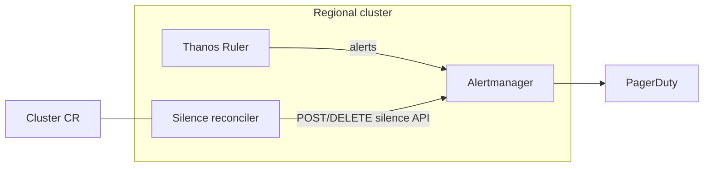

# Lifecycle alert silencing for Seaplane

**Last Updated Date**: 2026-11-03

## Summary

Replace PromQL `unless` lifecycle exclusions in regional alert rules with **Alertmanager silences** managed by a **stateless Seaplane silence reconciler** that watches `Cluster` resources and writes to the **regional cluster (RC) Alertmanager** using the Alertmanager v2 silence API (`POST /api/v2/silences`, `DELETE /api/v2/silence/{silenceID}`).

**Status:** The hyperfleet-operator silence reconciler is deployed ([ROSAENG-62371](https://redhat.atlassian.net/browse/ROSAENG-62371)). PromQL `unless` exclusions have been removed from the SLA burn-rate alerts ([ROSAENG-62372](https://redhat.atlassian.net/browse/ROSAENG-62372)). `hcp:lifecycle_installing` and `hcp:lifecycle_deleting` remain because `HCPInstallTimeout15m` and the MC/RC health dashboards still query them. Those series are not the silence predicate.

## Context

- **Problem Statement**: Install/delete suppression used to be embedded in every SLA alert expression (`unless on(namespace, name, cluster) (hcp:lifecycle_installing or hcp:lifecycle_deleting)` in [hcp-sla.yaml](../../argocd/config/regional-cluster/alerting-rules/templates/hcp-sla.yaml)). Each new alert had to remember the wrapper; new reasons (limited support, maintenance) would have required more recording rules; lifecycle logic lived in metrics instead of the control plane that already owns cluster state. Those expressions now contain only SLO logic.
- **Constraints**: Evaluation and paging run on the RC ([alerting architecture](alerting-architecture.md)); silences must scope per HostedCluster; install-timeout alerts must remain fireable during install ([hcp-installation.yaml](../../argocd/config/regional-cluster/alerting-rules/templates/hcp-installation.yaml)).
- **Assumptions**: Control plane is **seaplane-operator** + **seaplane-db** ([regional architecture](regional-control-plane-architecture.md)); MVP talks to in-cluster RC Alertmanager over Kubernetes `Service` DNS.

Prior RHOBS direction prefers **Alertmanager silence API + an external lifecycle caller** over PromQL wrappers ([Observatorium silence API #904](https://github.com/observatorium/api/pull/904), [OpenAPI spec](https://github.com/observatorium/api/blob/main/client/spec.yaml)).

## Alternatives Considered

1. **Keep / expand PromQL `unless` wrappers**: Rejected — does not scale as alert and lifecycle-reason cardinality grows.
2. **Embed silence logic in the main seaplane-operator reconciler**: Rejected — couples paging policy to the primary reconcile loop; harder to test and operate independently.
3. **Persist silence IDs in seaplane-db**: Rejected — couples correctness to two stores; Alertmanager list + Cluster CR diff is sufficient.
4. **Customer-facing silence API**: Out of scope — privileged ops remain mediated via ZOA.

## Design Rationale

- **Justification**: `Cluster` status already carries lifecycle phase and conditions. A dedicated reconciler maps that signal to Alertmanager silences so alert rules only express SLO logic.
- **Comparison**: PromQL suppression duplicates state and drifts; API silences are the standard Alertmanager mechanism and align with upstream RHOBS API work.

## Design

### Components



**Principle:** PromQL answers whether an SLO is burning; silences answer whether humans should be notified for a given cluster right now.

### Reconciler ownership and sharding

Add a **dedicated, stateless silence reconciler** (controller-runtime) that:

1. Uses `For(&v1alpha1.Cluster{})` — the same pattern as `ClusterReconciler` and `PlacementReconciler` — so it plugs into the existing **namespace sharding model** with no new watches.
2. Derives desired silences from the cluster's `.Status.Phase` and conditions. **MVP:** `installing` and `deleting` only; `limited_support` and `maintenance` follow once per-state exemption policies are defined.
3. Each reconcile:
   - **List** silences with `GET /api/v2/silences?filter=namespace="<ns>"&filter=name="<name>"`.
   - **Filter locally** to silences where `createdBy=hyperfleet-silence-reconciler` and `status.state=active`. The comment is `lifecycle=<reason> namespace=<ns> name=<name>`.
   - **Diff** against the desired silence, then create, replace, or expire.
   - A deleted Cluster CR is not finalized. Its silence stays until the 6h TTL. `DeletionTimestamp` while the CR still exists switches the silence to `deleting`.

**Sources of truth:**

- **Cluster CR** → what silences _should_ exist
- **Alertmanager** → what silences _do_ exist

No third store. No persisted silence IDs, intent hashes, or `endsAt` in seaplane-db.

Each desired silence is keyed by the Cluster CR `namespace` and `name` with `createdBy=hyperfleet-silence-reconciler`. If a prior `Create` succeeded but the reconciler crashed before finishing, the next reconcile's `List` sees the existing silence and skips creation.

**Orphan / drift handling:** On each reconcile, owned active silences for that cluster that are not the desired one are expired. There is no startup scan. A silence whose Cluster CR is already gone expires by TTL.

### Lifecycle states

| State             | Meaning                                                                                                                       | MVP |
| ----------------- | ----------------------------------------------------------------------------------------------------------------------------- | --- |
| `installing`      | Cluster provisioning in progress                                                                                              | Yes |
| `deleting`        | Cluster teardown in progress                                                                                                  | Yes |
| `limited_support` | Cluster marked limited support — **platform-api** writes the condition; **seaplane-operator** projects it to `Cluster` status | No  |
| `maintenance`     | Planned SRE maintenance window — **platform-api** sets the maintenance condition; operator projects to `Cluster` status       | No  |

`limited_support` and `maintenance` are out of MVP until per-state exemption matchers are approved (see below). The reconciler reads only `Cluster` status — never a separate flag source.

Shipped phase mapping (`IntentForCluster`):

| Cluster status                                                            | Silence reason |
| ------------------------------------------------------------------------- | -------------- |
| `WaitingForPlacement` or `Provisioning`                                   | `installing`   |
| `Deleting`, or any `deletionTimestamp` (including while phase is `Ready`) | `deleting`     |
| `Ready`                                                                   | none (expire)  |
| Any other phase                                                           | none (expire)  |

`Ready` is set when the HostedCluster `Available` condition is true and `Degraded` is not. A later availability loss does not move the phase back to `Provisioning`, so that outage is not silenced.

`hcp:lifecycle_installing` is a different signal. It exists only while HyperShift reports waiting for initial availability, so it is absent during `WaitingForPlacement` (no HostedCluster yet) and it stops once the cluster has been available. Dashboards can show "not installing" while the burn alerts are still silenced. That is expected.

### Lifecycle behavior

- **Enter silencable state** → `POST /api/v2/silences` with TTL (skip if one matching owned silence already exists).
- **While state persists** → when less than 1h remains, `POST` a new silence, then `DELETE` the previous one. Create runs first so a failed expire leaves the replacement in place. In-place update of the same silence id is not used.
- **Leave state** → `DELETE /api/v2/silence/{silenceID}`.
- **Ambiguous API responses** → bounded retries; next reconcile re-lists from Alertmanager before creating.

Suggested TTLs (each renewal sets `endsAt = now + renewal_window`):

| Reason                    | Initial window   | Renew when remaining  | Renewal window                               |
| ------------------------- | ---------------- | --------------------- | -------------------------------------------- |
| `installing` / `deleting` | 6h               | < 1h                  | 6h                                           |
| `limited_support`         | 24h              | < 4h                  | 24h                                          |
| `maintenance`             | Until window end | < 30m before `endsAt` | Extend to window end, or +4h if no fixed end |

Example for install: cluster enters `WaitingForPlacement` or `Provisioning` at T0 → silence `endsAt = T0 + 6h`. At T0+5h15m (< 1h left) the reconciler POSTs a new silence with `endsAt = now + 6h`, then deletes the previous one. Repeats until the cluster is `Ready` or the silence reason changes, then DELETE.

### Matchers and exemptions

Scope silences on HostedCluster identity labels: `namespace` (`cluster-<uuid>`) and `name` (cluster CR name). Those match the `namespace` and `name` labels on SLA burn-rate alerts. The `cluster` label (management cluster) stays on the alert and is not a silence matcher; namespace is unique per hosted cluster.

**MVP exemption (installing):** use an explicit Alertmanager negative matcher — `alertname` / `HCPInstallTimeout15m` / `isEqual: false` / `isRegex: false` — not shorthand `!=` syntax.

```json
{
  "name": "alertname",
  "value": "HCPInstallTimeout15m",
  "isRegex": false,
  "isEqual": false
}
```

| Lifecycle state | Silence? (MVP) | Exemption notes                                                |
| --------------- | -------------- | -------------------------------------------------------------- |
| Installing      | Yes            | Exclude install-timeout alert via negative `alertname` matcher |
| Deleting        | Yes            | No additional exemptions identified for MVP                    |
| Limited support | No (post-MVP)  | Requires billing/security-critical exemption policy            |
| Maintenance     | No (post-MVP)  | Requires per-window exemption policy                           |
| Available       | No             | —                                                              |

**Label contract:** SLA burn-rate alerts must carry `namespace`, `name`, and `cluster` labels (true for [hcp-sla.yaml](../../argocd/config/regional-cluster/alerting-rules/templates/hcp-sla.yaml)). Silences match `namespace` and `name`, which are the HostedCluster identity (`cluster-<uuid>` / cluster name). `cluster` stays on the alert for routing and dashboards. `promtool` tests assert those labels on the burn-rate alerts.

### Client abstraction

```go
type SilenceClient interface {
    List(ctx context.Context, matchers ...Matcher) ([]Silence, error)
    Create(ctx context.Context, s PostableSilence) (id string, err error) // create; renew is a new silence, then expire the old one
    Expire(ctx context.Context, id string) error                            // DELETE /api/v2/silence/{id}
}
```

MVP implementation uses in-cluster Alertmanager v2 HTTP.

### Migration

1. Ship reconciler; dual-run PromQL `unless` + API silences for one release. **Done** ([ROSAENG-62371](https://redhat.atlassian.net/browse/ROSAENG-62371)).
2. **Migration gates:**
   - `promtool` asserts `namespace`, `name`, and `cluster` on both burn-rate alerts, and asserts those alerts still fire while the lifecycle series are present. **Done.** PromQL tests cannot prove Alertmanager suppresses notification.
   - hyperfleet-operator tests cover the silence API side: matcher unit tests exempt `HCPInstallTimeout15m` during install, and the integration test creates an installing silence for `Provisioning`, expires it on `Ready`, and replaces it with a deleting silence on `Deleting`. A test that posts a firing alert and asserts notify versus silence was not added. Matchers are `namespace` and `name`, the same HostedCluster identity the burn alerts carry.
3. Remove `unless` from SLA alert expressions. **Done** ([ROSAENG-62372](https://redhat.atlassian.net/browse/ROSAENG-62372)). Lifecycle recording rules stay: `hcp:lifecycle_installing` feeds `HCPInstallTimeout15m`, and both series feed the MC/RC health dashboards.
4. Add `limited_support` / `maintenance` intents after exemption policies are approved.

## Consequences

### Positive

- Lifecycle suppression decoupled from individual alert expressions
- New lifecycle reasons do not require editing every PromQL rule
- Stateless reconciler — no silence bookkeeping in seaplane-db
- Aligns with RHOBS Alertmanager silence API direction

### Negative

- Additional reconciler to deploy and monitor
- Silence drift possible if reconciler or Alertmanager is unavailable — mitigated by TTL and reconcile loops

## Cross-Cutting Concerns

### Security

- Dedicated reconciler **ServiceAccount** and **NetworkPolicy** restricting Alertmanager API access to reconciler pods only
- No customer-facing silence write path; ZOA mediates privileged operations

### Reliability

- **Resiliency**: TTL-bound silences; list-and-diff reconcile each pass. PromQL no longer suppresses install/delete, so a reconciler or Alertmanager outage can page on clusters in those phases until the silence is created or renewed.
- **Observability**: Metrics for active silences, reconcile errors, and renewals

| Risk                              | Mitigation                                                                                                         |
| --------------------------------- | ------------------------------------------------------------------------------------------------------------------ |
| Silence API unavailable at create | Retries; alerting on Alertmanager issues. Burn-rate rules still fire; paging resumes until the silence is created. |
| Orphan silence after crash        | TTL expiry; next reconcile expires owned silences not in desired set                                               |
| Exemption misconfiguration        | Matcher unit tests; per-reason negative `alertname` matchers                                                       |
| Alerts missing identity labels    | Label contract on SLA rules; review on alerting-rules changes                                                      |

## Out of scope

- Customer-facing silence API
- SNS / PagerDuty routing changes
- Silencing on MC-local Prometheus
- Classic OSD clusters (ROSA HCP regional only)

## Future: Observatorium / shared RHOBS API

> **Not part of the MVP.**

The MVP uses **Alertmanager inside the regional cluster**. The **Observatorium tenant silence API** only matters if Seaplane hosts **full RHOBS per region** as a shared service rather than deploying observability components per RC today — a separate decision, not close in maturity.

If that path is taken later: tenant-scoped silence CRUD ([spec](https://github.com/observatorium/api/blob/main/client/spec.yaml), [#904](https://github.com/observatorium/api/pull/904)); gateway enforcer may require DELETE + POST for renew ([enforcer](https://github.com/observatorium/api/blob/main/api/metrics/v1/alertmanager_enforcer.go)); `SilenceClient` absorbs the transport swap.

## References

- [ROSAENG-62370](https://redhat.atlassian.net/browse/ROSAENG-62370) (spike)
- [ROSAENG-62371](https://redhat.atlassian.net/browse/ROSAENG-62371) (implementation)
- [ROSAENG-62372](https://redhat.atlassian.net/browse/ROSAENG-62372) (remove PromQL `unless`)
