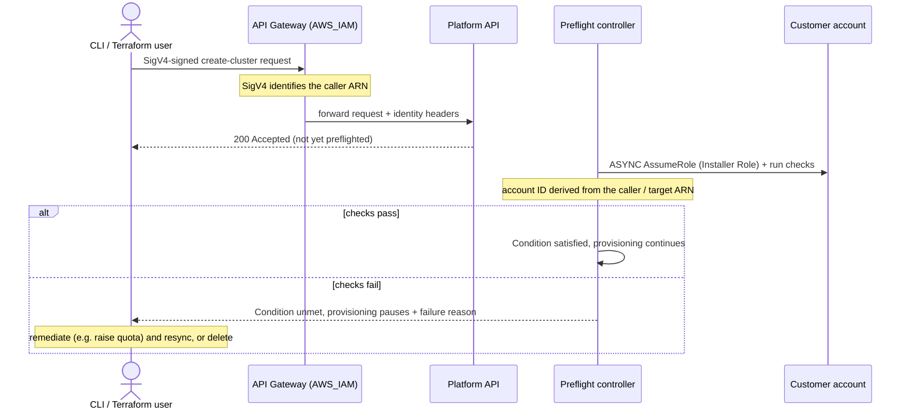
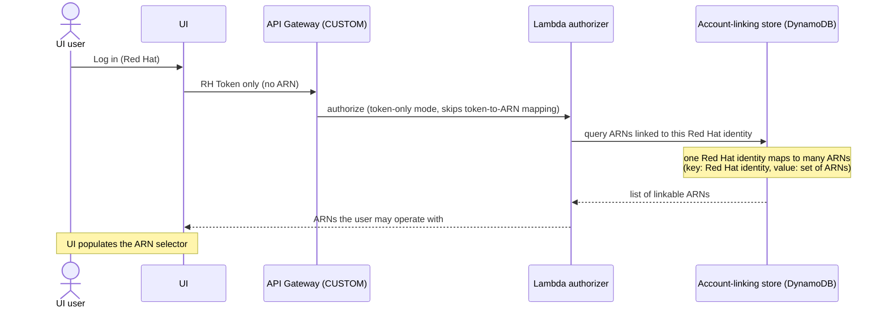
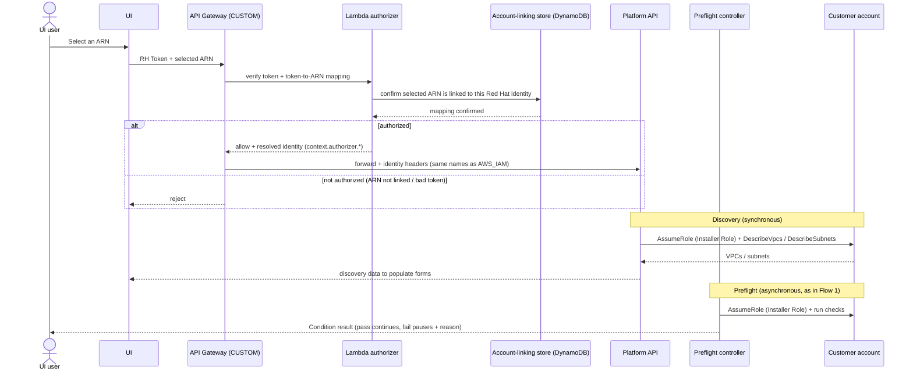
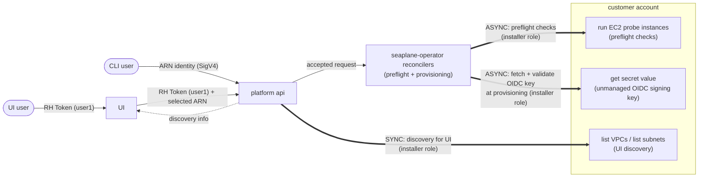
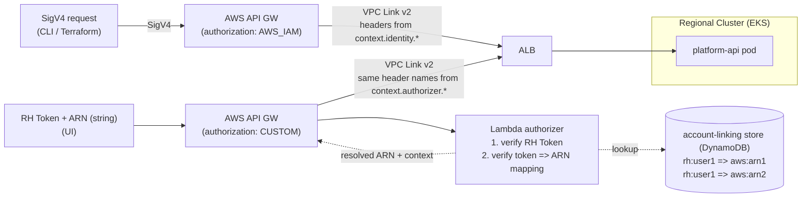

# Preflight Checks and UI Login Flows

**Last Updated Date**: 2026-11-13

## Summary

ROSA V2 (Seaplane) retains the ROSA V1 **installer-role** model for customer-account access. The Seaplane service assumes the customer's Installer Role to do three things:

1. **Discovery for the UI**: fetch customer resources (VPCs, subnets, and so on) **synchronously** so the cluster-creation UI can populate its forms.
2. **Preflight checks**: validate the customer account **asynchronously** via a controller, reproducing the V1 check coverage, before provisioning proceeds.
3. **Unmanaged OIDC signing key**: read the RSA private key the customer stores in their Secrets Manager for a self-managed (unmanaged) OIDC cluster. V2 will not perform synchronous checks at registration, and will instead bubble up the failure via the cluster Condition.

CLI/Terraform/CAPA clients authenticate with **SigV4** through the existing `AWS_IAM`-mode API Gateway. The UI authenticates with an **RH Token** through a second, custom-authorizer API Gateway that resolves the token to a customer-linked ARN, then presents the backend with the **same identity header names** the `AWS_IAM` gateway produces (populated from the authorizer response rather than the native IAM identity; see Architecture).

There is **no OCM role** in this design, and preflight are kept but run asynchronously. The Installer Role is kept **as-is** (same managed policy as V1) for now. The one new hard requirement is that the customer's installer-role trust policy **must define an `sts:ExternalId`**; V2 will refuse to provision clusters for accounts that have not.

## Context

- **Problem Statement**: V2 needs to decide where customer-account operations run. An earlier evaluation weighed removing the installer role entirely (moving preflight/discovery into a client SDK or onto an expanded OCM role) against retaining the V1 backend role-assumption model. Removing the installer role reduces the standing access granted to Red Hat, but the AWS permissions to perform the same operations do not disappear; they move onto whichever identity executes them (every CLI user, an expanded OCM role, or a dedicated backend role). The UI, which cannot run a client SDK, needs a privileged backend path regardless.
- **Decision forum**: ROSA Seaplane team sync, 2026-11-12. The team agreed to stay with the V1 installer-role flow and "double down" on `ExternalId`.
- **Assumptions**:
  - The Installer Role managed policy used in V1 already covers both the discovery reads and the preflight operations V2 needs. This is kept intact initially and audited later.
  - Customers link one or more AWS ARNs to their Red Hat org/user ahead of using the UI (account linking), so the service can resolve a token to an authorized ARN.
- **Out of Scope**:
  - Per-cluster HyperShift operator roles and the worker/node policies; these are cluster-specific and unchanged by this decision.
  - Customer-supplied secrets that are **submitted through the authenticated API** rather than fetched from the customer account: IDP secrets (OAuth client secrets, LDAP bind passwords) and additional trust bundles. In V1 these do not use the installer role (they are posted as values), so they are not part of this installer-role design. The self-managed-OIDC signing key is different: V1 fetches it from the customer's Secrets Manager via the installer role, so it **is** in scope here as the third use below.
  - Designing a new reduced-permission replacement for the installer policy (a possible future follow-up, see Consequences).

## Architecture

The Installer Role is used in exactly three places, distinguished by caller and timing:

| Use                        | Caller                           | Timing           | Customer-account actions (examples)                                                             |
| -------------------------- | -------------------------------- | ---------------- | ----------------------------------------------------------------------------------------------- |
| Discovery for the UI       | UI through Platform API          | **Synchronous**  | `ec2:DescribeVpcs`, `ec2:DescribeSubnets`, and similar reads                                    |
| Preflight checks           | Preflight controller (see below) | **Asynchronous** | Read-only validations plus write probes (for example the network verifier's `ec2:RunInstances`) |
| Unmanaged OIDC signing key | Provisioning reconciler          | **Asynchronous** | `secretsmanager:GetSecretValue` on the customer's key secret                                    |

The **preflight controller** (and the provisioning-time OIDC key fetch) is expected to be a reconciler inside the existing `seaplane-operator` rather than a separate service, so the single source of truth for cluster state stays in one place (see [Regional Control Plane Architecture](regional-control-plane-architecture.md)).

### Flow 1: CLI with preflight checks

A CLI or Terraform request is authenticated by the `AWS_IAM` gateway and accepted immediately; preflight then runs asynchronously and gates provisioning through a **Condition**:

### Flow 2: UI login with discovery API

The UI authenticates with an **RH Token** through the custom-authorizer gateway. The token-to-ARN mappings live in a **DynamoDB** account-linking store, and a single Red Hat identity can be linked to **multiple** AWS ARNs. So the UI runs two steps: first it asks for the list of ARNs the user may operate with (Flow 2a), then it sends each real request with one selected ARN (Flow 2b).

#### Flow 2a: list linkable ARNs (token only)

The UI calls a token-only endpoint. The Lambda authorizer validates the token and looks the Red Hat identity up in DynamoDB, which returns the (possibly many) linked ARNs used to populate the selector:

#### Flow 2b: operate with a selected ARN

Every other UI request carries one selected ARN. The authorizer verifies the RH token and confirms, against DynamoDB, that the selected ARN is actually linked to that Red Hat identity before the request reaches the backend. Discovery is synchronous, preflight asynchronous (as in Flow 1):

### Flow 3: Unmanaged OIDC signing-key retrieval

For a unmanaged OIDC, the customer owns the OIDC issuer and stores the RSA private signing key in their own AWS Secrets Manager. They register an OIDC config supplying the issuer URL and the secret ARN; Seaplane never stores the key, it reads it from the customer account via the installer role.

V1 reads and validates the key in **two moments**: a synchronous `GetSecretValue` plus RSA-parse plus issuer-reachability check when the config is registered or patched, and an asynchronous re-read at provisioning. **V2 collapses this to the asynchronous path only.** Because V2 can surface failures quickly through the cluster Condition (the same mechanism preflight uses), there is no need to pay a synchronous cross-account round trip at registration just to produce an actionable error; the provisioning reconciler does the real validation and bubbles any problem back fast.

However, V2 will perform a synchronous local check at registration to validate the account ID in the secret ARN.

### Request handling and installer-role usage

This diagram shows the request handling and installer-role usage for UI discovery, preflight checks, and unmanaged OIDC signing-key retrieval.

### Identity and API Gateway routing

This diagrams shows the component topology for the identity and API Gateway routing for both UI and CLI requests.

### ExternalId requirement

Today some customers configure the installer-role trust policy **without** an `sts:ExternalId` condition. This is not the desired pattern; see the AWS guidance on [granting third-party access to AWS resources](https://docs.aws.amazon.com/IAM/latest/UserGuide/id_roles_common-scenarios_third-party.html). In V2, Seaplane will **not** allow a customer to provision clusters unless `ExternalId` is defined in their trust policy.

## Alternatives Considered

1. **Move preflight and discovery into a client SDK (remove the installer role).** The CLI/Terraform clients would resolve customer AWS credentials locally and run the checks before submitting the request. Rejected: the UI cannot run an SDK, so a privileged backend path is still required; shared-VPC, zero-egress, and zero-operator-access flows were not re-validated against it; it shifts the full permission burden onto every executing identity (breaking V1's separation of personas, where one person creates the role and others with minimal permissions can create clusters); the network verifier would run sequentially in the client and take longer; and SDK version skew across CLI, Terraform, and other integrations would fragment check coverage.
2. **Use a service-controlled OIDC** the customer's trust, instead of trusting the role. This does not work because there can be no cross-account trust policies for OIDCs, which would force us to create one per account per customer and region.
3. **Hybrid: SDK for automation, installer role only for the UI.** Rejected: maintaining two execution paths is an operational and support burden ("management nightmare"), and the UI path would still need the broad permissions, so little is gained.
4. **Introduce a new, narrower custom backend role now.** Deferred rather than rejected: worthwhile only if it removes materially more than a handful of permissions. The decision is to reuse the existing V1 installer managed policy now and **audit actual usage later** to decide whether a reduced V2 policy is worth publishing.
5. **Retain the V1 installer-role backend model (chosen).** Keep one role concept, reuse a proven flow, and add only the `ExternalId` requirement.

## Design Rationale

- **Justification**: Retaining the installer role is the lowest-risk path to delivery. It reuses a model already in production and already understood by customers, keeps shared-VPC, zero-egress, and zero-operator-access flows untouched, and preserves the separation-of-personas property (a privileged user sets up the role; minimally privileged users create clusters). Because the UI needs a privileged backend path no matter what, a single installer role is simpler than maintaining an SDK path plus a separate UI-only role.
- **Evidence**: V1 already performs discovery and preflight through the installer role in production. The only genuinely new customer-facing requirement is `ExternalId`, which is a single predicate added to a trust policy that already exists. Service-owned `ExternalId` is itself an established pattern: V1's OCM-role trust already uses the Red Hat org ID as its `ExternalId` today, so the uniqueness model is proven rather than hypothetical. The existing `AWS_IAM` API Gateway already defines the backend identity-header contract that the UI's custom gateway reproduces.
- **Comparison**: The SDK approach (Alternative 1) and the OCM-expansion approach (Alternative 2) both fail to serve the UI cleanly and either widen blast radius or push unresearched risk onto shared-VPC and egress flows. The hybrid (Alternative 3) doubles the surface area. A new narrow role (Alternative 4) is attractive but premature until we have measured which installer permissions are actually exercised.

## Consequences

### Positive

- **Minimal migration risk**: existing shared-VPC, zero-egress, and zero-operator-access customers keep working on the model they already use; nothing about those flows has to change for V2.
- **One role concept** instead of the V1 tangle of OCM-role variants plus installer role, which is simpler to explain and operate.
- **Centrally maintained checks**: preflight logic stays server-side, so coverage can be updated without shipping SDK versions and waiting for clients to upgrade.
- **UI/CLI parity**: UI users get the same preflight coverage as CLI users, including write-level probes (for example the network verifier) that a read-only role could not perform.
- **Uniform backend identity**: the custom-mode gateway presents the same identity header names as the `AWS_IAM` gateway, so the backend largely avoids special-casing UI vs CLI requests (with the `X-Amz-Principal-Org-Id` caveat noted in Security).

### Negative

- **No reduction in standing access to Red Hat (for now)**: retaining the installer role keeps the broad V1 permission set. Reducing it is explicitly a possible follow-up, not part of this decision.
- **New components to build and operate**: a custom-authorizer API Gateway, the Lambda authorizer, the account-linking store, the token-to-ARN resolution endpoint, the asynchronous preflight controller with Condition-based gating, and the OIDC key handling (asynchronous retrieval, RSA and issuer validation, and materialization of the signing-key Secret onto the MC, all gated by the same Condition mechanism).
- **`ExternalId` enforcement is a gate**: customers whose trust policy lacks `ExternalId` cannot provision in V2 until they update it; this must be communicated and documented clearly.
- **Customer-pressure friction on `ExternalId`**: some customers ask to supply their own value; the service must hold the line on guaranteeing uniqueness (own the value, or prefix an org-scoped component), which requires strong documentation and possibly AWS engagement.

## Cross-Cutting Concerns

### Reliability:

- **Scalability**: Discovery is a synchronous per-request `AssumeRole` plus `Describe*` call with no persisted state, scaling directly with UI traffic. Preflight runs in an asynchronous controller bounded by its reconcile loop, decoupled from request acceptance. The network verifier launches temporary EC2 probes, so its concurrency and timeout must be bounded (as in V1).
- **Observability**: Every `AssumeRole` and customer-account API call is visible in CloudTrail in **both** the Red Hat and customer accounts. The cluster **Condition** surfaces preflight status and the failure reason to the user. The custom API Gateway and Lambda authorizer emit their own request and authorization logs.
- **Resiliency**: A failed preflight **pauses** provisioning without discarding the request, so the user can remediate and resync or delete. Whether an endpoint failure in the network verifier **blocks** or merely **warns** is governed by the same HCP feature toggle as V1.

### Security:

- **Confused-deputy mitigation**: Mandatory, service-owned `ExternalId` is the core control. The service guarantees uniqueness; a fully customer-chosen value that could collide across tenants is not permitted.
- **UI trust boundary**: The Lambda authorizer is the trust boundary for UI requests. It must verify the Red Hat token **and** enforce the token-to-ARN linking; it must never trust a client-supplied ARN without confirming the mapping. The ARN selector is populated only from the server-resolved list.
- **Public custom endpoint**: Unlike the `AWS_IAM` gateway, which rejects unsigned requests before any custom code runs, the custom-authorizer gateway is a public endpoint whose authentication is entirely Lambda code. The authorizer is security-critical and should be treated as such (least privilege, tested, monitored).
- **`X-Amz-Principal-Org-Id` on the UI path**: this header is derived natively from IAM/STS for SigV4 requests, but there is no native source for a customer ARN resolved from the account-linking store. For UI requests the Lambda authorizer must populate it explicitly (for example from the account-linking record) or leave it absent.
- **Unmanaged OIDC key is sensitive material**: the customer's RSA private signing key is read from their account and materialized as a Kubernetes Secret on the MC. It must not be logged, echoed in API responses or errors, or persisted outside the control plane's signing-key Secret. The V1 installer policy scopes `secretsmanager:GetSecretValue` to secrets tagged `red-hat-managed=true`; this carries over.
- **Broad installer role**: Retaining the V1 policy keeps broad cross-account write access to customer accounts; this is an accepted trade-off now, with a reduced-permission role as a potential future follow-up.

### Performance:

- Synchronous discovery adds `AssumeRole` plus `Describe*` latency to UI form loads; acceptable, and results can be cached per session if needed.
- Preflight is asynchronous, so it never blocks request acceptance; the network verifier (the slowest check) runs as an in-flight check rather than inline, matching V1.

### Cost:

- Additional custom API Gateway and Lambda-authorizer invocations per UI request.
- Temporary EC2 probe instances for the network verifier (an existing V1 cost, unchanged).
- A small account-linking store (token-to-ARN mappings).

### Operability:

- New surface area to deploy and run: custom gateway, Lambda authorizer, account-linking store, and the preflight controller.
- **Documentation is a deliverable**: the `ExternalId` requirement and its uniqueness model must be documented extremely well (public-facing), with AWS engaged if needed, so field teams and customers understand why the service owns the value.
- **Audit follow-up**: instrument and review which installer-role permissions are actually exercised in V2 to inform a future decision on publishing a reduced-permission policy.

## Open Questions

1. **Reduced installer policy**: after the flow is proven, does an audit show enough unused permissions to justify publishing a narrower V2 installer policy?
2. **`ExternalId` customer-supplied component**: do we allow a customer-supplied suffix behind a service-controlled, org-scoped prefix, or require a fully service-generated value?

## Related Documents

- `terraform/modules/api-gateway/integration.tf`: the `AWS_IAM` identity-header contract this design reproduces for the UI path.
- `docs/design/regional-control-plane-architecture.md`: `seaplane-operator` as the controller and single source of truth for cluster state.
