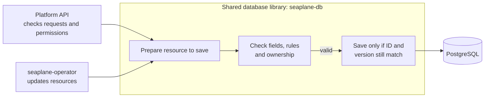
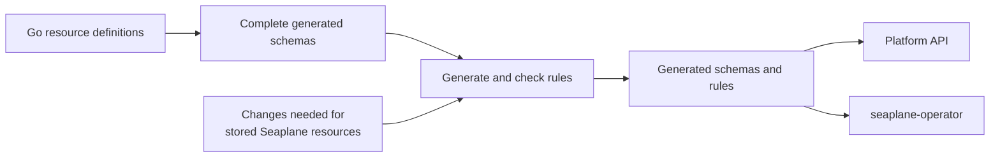
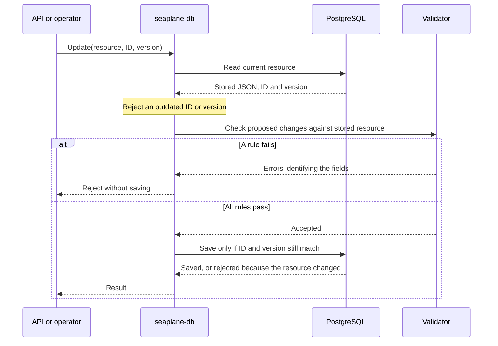

# Shared Resource Validation for Seaplane

**Last Updated Date**: 2026-11-19

**Status**: Proposed

**Epic**: [ROSAENG-67906](https://redhat.atlassian.net/browse/ROSAENG-67906)

**Design**: [ROSAENG-76410](https://redhat.atlassian.net/browse/ROSAENG-76410)

**Implementation**: [ROSAENG-76411](https://redhat.atlassian.net/browse/ROSAENG-76411)

## Summary

The Platform API and seaplane-operator will check resources against the same
rules before saving them to PostgreSQL. These checks will come from the resource
definitions and run in `seaplane-db`, the database library both applications use.

## Context

- **Problem Statement**: The resource definitions already describe allowed fields,
  values, and changes. Kubernetes normally enforces these rules, but Seaplane saves
  resources directly to PostgreSQL. Some checks exist in the API, but operator
  writes do not pass through them. Maintaining separate checks also makes it
  easy for the code and definitions to disagree.
- **Constraints**:
  - Keep PostgreSQL as the database. Do not add a Kubernetes API server or a
    separate validation service.
  - Apply the same rules to API and operator writes.
  - Validate Seaplane resources, not the HyperShift resources generated from them.
  - Reject outdated updates.
  - Keep configuration and status changes separate.
  - Allow cleanup during deletion.
  - Keep permission checks and rules about customer-editable fields in the API.

- **Assumptions**: Normal API and operator writes go through `seaplane-db`.
  Validation rules ship with the applications. Direct database access remains
  restricted to trusted administrators and tools.

This design covers Cluster, NodePool, OidcConfig, DNSReservation, Placement,
ManagementCluster, and Index in `seaplane.io/v1alpha1`. It excludes the saved
copies of generated HostedCluster and NodePool resources in
`hypershift.openshift.io/v1beta1`.

## Architecture

### Where Validation Runs

Both applications already use `seaplane-db` to save resources. Put validation
there, just before a write can change the database or send a change notification.

These checks run inside each application, not in a new service. Each application
supplies the generated schemas and rules when it starts. The database library
checks them without importing the Seaplane resource types.

A schema describes allowed fields and values. Common Expression Language (CEL)
rules add checks that compare fields or compare the old and new versions of a
resource. Both kinds of check are needed.

Identify resources by API group, version, and kind, not kind alone: Seaplane and
HyperShift both have a NodePool type. Only the two HyperShift types listed above
are excluded. If any other type has no schema, reject the write.

The API still checks who the caller is, what they may change, which features are
enabled, which fields they may supply, and whether they may use a parent Cluster
or another account's resource. Shared validation does not replace those checks.

### How the Rules Are Built

Generate schemas from the Go resource definitions, including the imported
HyperShift types. Do not use the public API schema, which leaves out
platform-owned fields, or the test CRDs, which have many CEL rules removed.
CRDs are Kubernetes custom resource definitions.

Some imported rules assume a complete HyperShift resource. Adjust only the rules
that differ for stored Seaplane resources. Record these changes in JSON Patch,
a standard format for describing changes to a JSON document. Apply them during
generation, not while handling a write.

Generation must fail if the source schemas no longer match the expected input.
List which rules stay unchanged and which are replaced. Changes to imported types
therefore need review; they cannot silently drop checks or allow more values.
Keep the public API schemas and test CRDs unchanged.

Include ownership checks with the generated rules where CEL cannot read the
needed labels or owner fields. These checks are described below.

Both applications include the same generated rules in their builds and log a
rule-set ID calculated from their contents. This lets operators confirm which
rules each application loaded. Rules do not change while an application is
running; deploying new rules requires an application deployment.

### What Stored Resources Must Contain

Validate Seaplane resources, not the HyperShift resources generated from them.
The database must not generate a HyperShift resource or fill in defaults just to
make validation pass.

For example, a Seaplane NodePool can leave its upgrade type and release image
empty. When the operator generates the HyperShift NodePool, it chooses Replace
upgrades and uses the parent Cluster's release image.

Only the documented empty or missing values are allowed:

| Stored value                                             | Meaning                                                                                                                    |
| -------------------------------------------------------- | -------------------------------------------------------------------------------------------------------------------------- |
| Empty NodePool upgrade type                              | Use Replace when generating the HyperShift resource. Upgrade checks must account for that choice. Reject unsupported types |
| Empty NodePool release image                             | Use the parent Cluster's release image. Release changes remain allowed                                                     |
| Empty Cluster release image                              | Allow a release image to be supplied later. The database does not choose one                                               |
| Empty NodePool replacement strategy                      | Use the existing RollingUpdate default. Check any supplied rolling-update settings                                         |
| Missing Cluster networks or empty etcd mode              | Allow these to be supplied later. Check any supplied networks and etcd settings                                            |
| Null Cluster services list                               | No list was supplied. Check the contents if a list is supplied                                                             |
| NodePool root-volume size 0                              | Use the default later. Explicit sizes from 1 to 7 GiB are still invalid                                                    |
| Cluster with no DNS reservation or allocated hosted name | The platform may set these later. Once set, they cannot change or be removed                                               |

The same set-once rule applies to the account and NodePool parent references.
Network lists cannot change or disappear once set. The Cluster's OIDC reference
is fixed at creation, even if it starts empty. OIDC credential rules still
distinguish a missing field from a field containing an empty string.

Do not treat every zero, false, or null as missing. A replica count of zero and
an explicit false keep their existing meanings. A field that customers cannot
change may still need to be set by the operator after creation.

### How Updates Work

Check the data that will actually be saved. Configuration is stored in `spec`;
what the operator reports about the resource is stored in `status`. Metadata
holds other information, such as labels and owner details.

| Operation     | Data to check and save                                                                                     |
| ------------- | ---------------------------------------------------------------------------------------------------------- |
| Create        | The submitted configuration, status, and labels/other metadata, after existing API or operator preparation |
| Update        | The submitted configuration and metadata, with the status and deletion time already in the database        |
| Status update | The submitted status, with the configuration and metadata already in the database                          |

For rules that compare old and new values, CEL calls the old resource `oldSelf`.
Use the JSON already in the database for that value. Reading it into a Go
resource type first could add empty fields that were not present before, which
could change the result of a rule.

Check the same JSON that will be saved. Keep integers as integers when reading
JSON so large numbers are not rounded. Validation must not add defaults, remove
fields, or change values to make a resource pass.

An update must include the resource's unique ID (UID) and the version read from
the database. If another writer changes the resource, reject the update. The UID
also prevents an old update from changing a new resource that reused a deleted
resource's name.

Do not retry an outdated write automatically. The caller must read the resource
again, rebuild the update, recheck permissions where needed, and validate it
again. Keep the existing behavior that skips saves when nothing has changed.
No new database locks or transactions across several resources are needed.

### Ownership and Deletion

For account-owned resources, check that the namespace (`account-<id>`), account
label, and stored account agree. Also protect the recorded owner
(`ownerReferences`) and ownership labels that must not change. NodePools and
Placements must identify the same owning Cluster in their owner reference and
cluster-UID label.

These checks do not look up the parent or decide whether the caller may use it;
the API still does that. Labels recording which Cluster currently uses a DNS or
OIDC resource must remain changeable so controllers can claim and release it.

Delete must use the configuration, status, and metadata already in the database,
not copies supplied in the delete request. It marks the resource as being
deleted, or keeps the existing deletion time, and checks the ID and version.
This fixes the current versioned-delete path, which can also save fields from
the caller's object.

Finalizers are markers that keep a resource from being fully deleted until its
cleanup is done. Allow a controller to remove existing finalizers after cleanup,
even if unchanged fields in an old record fail the new rules. This exception:

- Allows no added finalizers or other intended changes.
- Preserves the saved configuration, status, and other metadata. Reading and
  saving the resource must not add empty fields or change anything except the
  finalizers being removed.
- Still requires permission checks and matching resource ID/version.

Other updates must follow all the rules. Being created before this change does
not give a resource a general exemption from validation.

## Alternatives Considered

1. **Check only in API handlers**: Operator writes would still miss the checks.
2. **Write separate Go checks for each resource**: Repeats rules already in the
   definitions and creates two places to maintain them.
3. **Use schemas without CEL**: Misses rules that compare fields or old and new
   values.
4. **Use the full HyperShift schema and add defaults before saving**: Requires
   values that Seaplane fills in later and changes what gets stored.
5. **Add a Kubernetes API server**: Adds infrastructure and changes the storage
   architecture to solve a problem the shared database library can handle.

## Design Rationale

- **Justification**: Both applications already use `seaplane-db`, so adding
  checks there covers both without adding a service or resource-specific SQL
  rules. Reuse Kubernetes' schema and CEL libraries rather than writing another
  version of those rules. Check stored Seaplane resources as they are; do not
  turn a database write into a request to generate HyperShift configuration.
- **Evidence**: The schema audit found 301 CEL rules in the complete definitions,
  but only 20 in the test CRDs. Basic Cluster and NodePool creates fail against
  the complete rules without the Seaplane-specific adjustments. The proposed
  adjustments pass those examples and focused tests of allowed and forbidden
  changes. Database integration and production performance are not yet verified.
- **Comparison**: This covers operator writes that API-only checks miss, without
  duplicating rules or adding a Kubernetes API server. It also avoids filling
  stored resources with HyperShift defaults before saving.

## Consequences

### Positive

- API and operator writes use the same rules.
- Rules stay tied to the resource definitions, with documented differences for
  the objects Seaplane stores.
- The database does not need to generate HyperShift resources or fix invalid
  input before saving it.
- Rejected writes leave records and versions unchanged and send no change
  notifications. Errors identify the fields that failed.

### Negative

- Kubernetes validation libraries add dependencies, startup work, and CPU/memory
  use. The production impact has not been measured.
- Changes to imported resource types require review of the Seaplane-specific
  adjustments. Passing validation does not guarantee that the operator can
  finish its work; required AWS resources, for example, might not be available.
- Existing records may fail the new rules. They must be checked and repaired
  before validation is enabled, or normal updates could stop working.
- Initial deployment needs a period with API and operator writes stopped, so old
  application versions cannot save invalid records during the switch.

## Cross-Cutting Concerns

### Reliability

- **Scalability**: Each API and operator process runs its own checks. Adding
  replicas does not require a separate validation service or coordination
  between validators.
- **Observability**: Log the rule-set ID so failures can be traced to the rules
  in use.
- **Resiliency**: Load schemas and prepare all CEL rules before accepting work.
  A missing schema or broken rule must stop startup, not disable validation.
  Check rules inside objects and lists, including rules that build error
  messages. Report database failures and cancelled requests separately from
  invalid-resource errors.
- **Tests**: Prove that rejected writes leave records unchanged, configuration and
  status updates stay separate, outdated writes are rejected, and cleanup cannot
  change unrelated fields. Also test missing fields, null, empty strings, zero,
  and false without treating them as interchangeable.

### Security

- Keep existing checks on caller identity, permissions, customer-editable fields,
  and account ownership. Passing validation does not grant permission to write.
- Return field names and safe explanations, not rejected values or messages
  calculated from secret data. Keep the existing API error format: HTTP 422 for
  Cluster/NodePool validation errors and HTTP 400 for OIDC/DNS validation errors.
- This protects application writes. It does not prevent an administrator with
  direct database access from bypassing the applications.

### Performance

- Prepare the rules once at startup and reuse them for writes. No extra service
  call is needed.
- Regular updates already read the stored resource. Status validation needs an
  additional read to get the configuration being checked. Measure the added
  database and validation time with representative resources before deployment.
- Use Kubernetes' existing limits on the work a CEL rule and a whole-resource
  check can use. Stop checks when the request is cancelled, and reject resources
  larger than 3 MiB.
- Kubernetes may reject a CRD if it predicts that its rules would take too much
  work. Some imported rules fail that check. Seaplane does not register these
  CRDs, so report this during generation rather than removing rules or raising
  work limits. Actual validation still has work limits.

### Cost

- No new service or database infrastructure is needed. Costs are application
  CPU/memory, database reads where needed, and maintaining the rule adjustments.
- Binary size, startup time, and write latency still need measurement.

### Operability

- Before turning on validation, check a copy of the current database records
  taken at one point in time. Check both the saved JSON and what the client
  would save if it read and updated each resource without intentional changes.
  Reading a resource into a Go type can add empty fields; those added fields can
  make an otherwise unchanged update fail. Check configuration and status
  updates separately. Report failed resources and fields without printing their
  values, and repair all active records that fail.
- For the initial deployment, stop API and operator writes using existing
  deployment controls. Repeat the check while writes are stopped, deploy both
  applications with the same rules, and then allow writes again. Reads may also
  be interrupted. Do not run old versions that skip validation alongside the new
  versions during this switch.
- Retrying an unchanged invalid update will not fix it. If a rollback is needed,
  roll back the applications and their rules together; do not automatically
  rewrite stored data.
- Update the database guidelines too. Their current advice to validate in the
  API will change for these shared checks; API-specific checks will stay in the
  API.

## Related Documents

- [Regional Control Plane Architecture](regional-control-plane-architecture.md)
- [seaplane-db Development Guidelines](https://github.com/openshift-online/rosa-seaplane-api/blob/main/docs/seaplane-db-guidelines.md)
- [Detailed Storage Schema Policy](assets/shared-resource-validation-policy.json): the exact
  field-level changes used to generate the rules. This is supporting detail,
  not required reading to understand the design.
