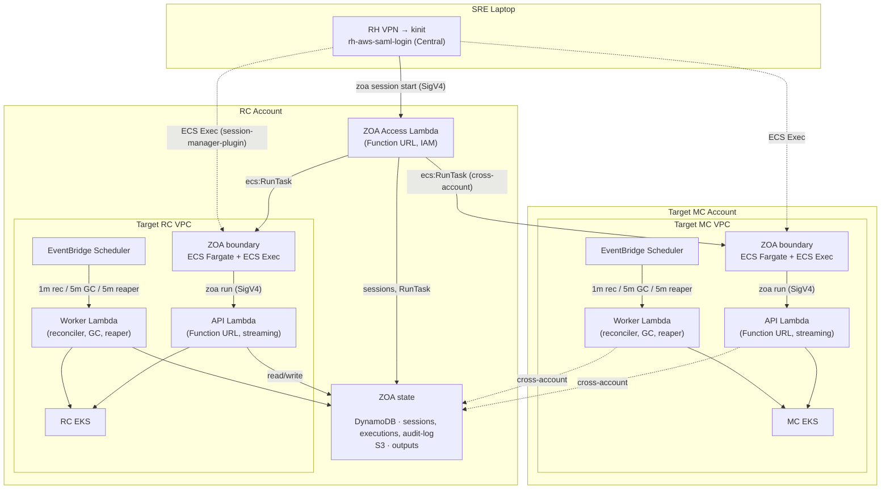

# Zero Operator Access (ZOA) — Architecture

**Last Updated Date**: 2026-10-23

## Summary

ZOA ensures that operators have **no persistent, interactive, or unaudited access** to customer infrastructure. Operators **start a boundary session** (audited shell in the target VPC), then run **Trusted Actions** from inside that environment — not `kubectl` or `zoa run` from the laptop. State and audit live in a regional serverless plane (Lambda, DynamoDB, S3, EventBridge).

ZOA is independent of the Regional Cluster's Platform API or any Kubernetes workload — the tool to fix the platform does not depend on the platform being healthy.

> For code-level architecture details (execution flows, SA isolation, streaming adapter, TA development), see the [ZOA repository documentation](https://github.com/openshift-online/rosa-seaplane-zoa/blob/main/README.md).

## Context

- **Problem Statement**: Traditional managed-service operations require operators to have standing access (kubeconfig, IAM roles, bastion hosts). This creates unaudited access paths, persistent credentials, no accountability, and compliance gaps. FedRAMP requires complete audit trails for all privileged operations.
- **Failure Domain Minimization**: The tool used to fix the platform must not depend on the platform being healthy. The **TA execution path** (the common case) has 3 failure domains — all AWS-managed: Lambda, DynamoDB, EKS API server. The **session path** (operator access) adds ECS Fargate — also AWS-managed. No custom Kubernetes controller workloads in the critical path **(for sync TAs)**; async TAs add short-lived `zoa-runner` Jobs on the target cluster. Lambdas and ECS tasks deploy per-VPC to isolate failure domains — one cluster's ZOA outage cannot cascade to another.
- **Constraints**: **Lambda** container images are pulled from ECR (mirrored from the CI registry); `zoa-runner` and `zoa-boundary` use source-registry image refs on EKS/ECS. Function URLs require IAM auth; cross-account access must use STS AssumeRole; all data encrypted at rest (KMS).
- **Assumptions**: Each target VPC has an EKS cluster reachable from the Lambda's subnet. DynamoDB is the shared state store (regional, in RC account). CLI authenticates via SigV4.

## Architecture

### Operator model (three pillars)

Production work is **boundary-first**: every path begins on the laptop with session management, continues in an ephemeral **boundary** task (ECS Exec), and uses **Trusted Actions** for reads and changes to fleet state. There is no supported workflow that grants standing cluster credentials on the laptop.

| Pillar              | Status  | Platform role                                                                                                                                                                                            |
| ------------------- | ------- | -------------------------------------------------------------------------------------------------------------------------------------------------------------------------------------------------------- |
| **Boundary**        | Shipped | Audited entry point — `zoa session start` / join; tools and shell in target VPC                                                                                                                          |
| **Trusted Actions** | Shipped | Declarative, RBAC-scoped operations via `zoa run` **from inside the boundary**                                                                                                                           |
| **Break-glass**     | Planned | Scoped emergency `kubectl` / AWS from the boundary — not implemented; see [break-glass stub](https://github.com/openshift-online/rosa-seaplane-zoa/blob/main/docs/break-glass/README.md) in the ZOA repo |

**Session path** (operator access): laptop → **Access** Lambda → boundary ECS → optional **TA path** below.

**TA path** (mutations and reads): boundary → per-VPC **API** / **Worker** Lambdas → EKS (and AWS APIs where the TA requires them). Sync TAs are the common case; async TAs use Worker + `zoa-runner` Jobs.

Operator guides and CLI detail: [ZOA documentation](https://github.com/openshift-online/rosa-seaplane-zoa/blob/main/docs/README.md). Resolved central `rh-aws-saml-login` targets and app-interface role setup: [rosa-hyperfleet-internal — ZOA operator access](https://github.com/openshift-online/rosa-hyperfleet-internal/blob/main/docs/onboarding/zoa-operator-access.md).

### Composite deployment

The pillars above map onto AWS as follows. **Access** is regional (RC account, no VPC). **Boundary** ECS runs in each target VPC. **API** and **Worker** Lambdas (same `zoa-lambda` image, `HANDLER_MODE`) run in each target VPC alongside that boundary.

Three **Lambda personalities** from one container image (`zoa-lambda`), selected by `HANDLER_MODE`:

| Lambda     | Where          | Invoke Mode         | Trigger                             | Purpose                                                                      | Timeout |
| ---------- | -------------- | ------------------- | ----------------------------------- | ---------------------------------------------------------------------------- | ------- |
| **Access** | RC (no VPC)    | `RESPONSE_STREAM`   | Function URL (IAM auth)             | Boundary session lifecycle; Central deployment discovery; RC target registry | 30s     |
| **API**    | Per target VPC | `RESPONSE_STREAM`   | Function URL (IAM auth)             | `zoa run`, sync TAs, streaming responses (from boundary only)                | 300s    |
| **Worker** | Per target VPC | _(no Function URL)_ | EventBridge Scheduler + self-invoke | Reconciler (1m), GC (5m), boundary reaper (5m); async Job lifecycle          | 300s    |

**Access** (`modules/zoa-access`) serves short HTTP requests from the laptop; `ecs:RunTask` is asynchronous. It resolves **targets** from RC SSM (`TARGETS_SSM_PREFIX`, same `/zoa/targets/<deployment>/…` tree as session start) and **deployments** from Central SSM (`/zoa/deployments/<deployment_name>`). Session **duration** and **idle** limits are enforced on the boundary ECS task and the Worker reaper — not by keeping an Access invocation open. **API** and **Worker** (`modules/zoa-lambda`) share VPC networking with the boundary task in that cluster. Reserved concurrency and other operational defaults are environment configuration (not repeated here); see [Configuration](#configuration).

All three modes enter through `lambda.Start()` from `aws-lambda-go`. **Access** and **API** use the same native Function URL streaming adapter (`pkg/lambdahttp`, up to 200MB). **Worker** handles EventBridge and self-invoke JSON events (no Function URL).

#### Availability (sync TA path)

**Composite sync TA availability: 99.95%** (~22 min/month budget). On that path, failure domains are AWS-managed: Lambda (99.95%), DynamoDB (99.999%), and EKS API (99.95%). Starting a **session** additionally depends on Access Lambda and ECS Fargate (99.99%). No `zoa-runner` Jobs sit in the critical path **(for sync TAs)**.



> For the complete architecture diagram including all component interactions, see the [ZOA README — Architecture](https://github.com/openshift-online/rosa-seaplane-zoa/blob/main/README.md#architecture).

### Authentication & Caller Boundaries

ZOA splits **who may call what** into a **session plane** (laptop → Access → boundary) and a **TA plane** (boundary → API, plus Worker for schedules and async work). Humans never authenticate to the Worker; they reach the fleet only after a boundary session exists.

```
Session plane (laptop)                    TA plane (inside target VPC)
─────────────────────                     ───────────────────────────

Central Account → Access invoker role       Boundary ECS task role (RunTask)
        │                                              │
        ▼                                              ▼
Access Function URL (RC, no VPC)            API Function URL (VPC-attached)
        │                                              │
        ▼                                              ▼
Access Lambda                               API Lambda  ◄── Worker (EventBridge / self-invoke)
sessions · targets · RunTask                zoa run · audit reads · streaming
```

#### ZOA Access Lambda (session plane)

The laptop talks only to **Access** for session lifecycle, deployment discovery (Central SSM), and target lookup (RC SSM) — not to per-VPC API Lambdas and not to Kubernetes. **`zoa run` is not supported from the laptop.**

1. Authenticate to the Central Account and assume the ZOA Access **invoker** role (same pattern as other Seaplane central roles).
2. `zoa session start <deployment> <target>` — e.g. `zoa session start us-east-1 mc01` (flags `-d`/`-t` for scripts).
3. CLI calls the **Access Function URL** (SigV4; deployment URL/invoker from Central SSM `/zoa/deployments/…`, targets from RC SSM `/zoa/targets/…`).
4. Access Lambda writes the session row, runs `ecs:RunTask` in the target VPC (cross-account for MC), injects `ZOA_API_URL` and session metadata, enables ECS Exec.
5. `zoa session join …` uses **ECS Exec** (`session-manager-plugin`) — not another Lambda hop.

Access resource policy + invoker role constrain **session APIs** (start, join credentials, list, terminate). They do **not** grant TA execution against cluster APIs.

#### Boundary task (audited shell)

The boundary is the handoff between session plane and TA plane. The task role is scoped to that VPC's API Function URL and supporting AWS APIs; it cannot call Access or mutate session rows.

Session logging: container stdout → `/ecs/<cluster_id>/zoa-boundary`; ECS Exec transcripts → `.../zoa-boundary/ssm-sessions` ([session logging](https://github.com/openshift-online/rosa-seaplane-zoa/blob/main/docs/boundary/session-logging.md)). **Session enforcement:** Worker **reaper** (every 5m) stops tasks past **deadline** (`SESSION_MAX_DURATION_HOURS` at start) or **idle** (`SESSION_IDLE_TIMEOUT_SECONDS`; see [session reaper](https://github.com/openshift-online/rosa-seaplane-zoa/blob/main/docs/boundary/session-reaper.md)).

#### Per-VPC API Lambda (TA plane — interactive)

From the boundary shell only, `zoa run` and read-only audit APIs call the local **API** Function URL (`ZOA_API_URL`, IAM auth). The ECS task role provides SigV4 identity. The API records caller ARN on every request and resolves the human operator via the **identity bridge** (task id → DynamoDB session).

#### Worker Lambda (TA plane — background)

The **Worker** shares the VPC execution role but has **no Function URL** and no laptop callers. EventBridge triggers reconciler (async Job polling, dispatch timeouts, resource GC), GC, and boundary reaper. On MC VPCs it reaches RC DynamoDB/S3 via **`zoa-data-access`** (same role assumption as the API execution role).

#### Trust separation

A principal with the **Access invoker** role can call all session APIs allowed by IAM (start, list, join, terminate, history). **Join** and **terminate** are **owner-only**: the Access Lambda compares the SigV4 caller identity to the `operator` stored on the session row. Cross-operator **session history** queries are permitted for holders of the invoker role and are **audited**. A compromised invoker still **cannot** run arbitrary TAs against cluster APIs without a boundary task. A **boundary task role** can reach only its VPC's API Lambda (and what TAs allow on EKS/AWS). **Worker** invocations are not operator-initiated — they extend TA lifecycle after API or schedule events.

### Execution Modes (Sync vs Async)

Each Trusted Action declares its execution mode. The mode determines how the TA runs and where output is generated:

|                       | Sync                                                       | Async                                                                           |
| --------------------- | ---------------------------------------------------------- | ------------------------------------------------------------------------------- |
| **Executor**          | API Lambda (inline in the dispatch request)                | K8s Job (`zoa-runner` container) on target EKS; Worker reconciler monitors Jobs |
| **Output delivery**   | Streamed in Lambda response (up to 200MB) + archived to S3 | Written to S3 by the Job; retrieved via API Lambda streaming (same 200MB limit) |
| **Use case**          | Read operations, quick mutations (seconds)                 | Long-running operations, large outputs, needs its own pod lifecycle             |
| **Timeout**           | Bounded by Lambda timeout (300s)                           | Bounded by K8s Job `activeDeadlineSeconds` (configurable per TA)                |
| **CLI experience**    | Blocks until complete, streams output                      | Returns immediately with execution ID; poll with `zoa get` or `--wait`          |
| **Output size limit** | 200MB (Lambda streaming)                                   | 200MB (retrieved via API Lambda streaming; S3 stores the full artifact)         |

Both modes create per-execution K8s RBAC (ServiceAccount + Role + RoleBinding) that is destroyed after completion. For `kube-api` scope TAs, the Lambda uses SA impersonation (`rest.ImpersonationConfig`) so the K8s audit log reflects only the declared RBAC — not the Lambda's own broad permissions. For async mode, a scoped STS Secret is also created (S3 upload-only credentials restricted to the execution's prefix via session policy). For `aws-api` scope TAs, dedicated IAM roles (`zoa-aws-read` / `zoa-aws-write`) are assumed per-execution via STS with a session policy scoped to the specific TA's declared permissions.

> For full sequence diagrams of both modes, see [Implementation Details](https://github.com/openshift-online/rosa-seaplane-zoa/blob/main/docs/architecture/implementation.md).

### Per-VPC Isolation

Each cluster's ZOA is fully independent — Lambdas, boundary ECS, and EventBridge are all VPC-scoped. A failure in one VPC cannot cascade — no cross-VPC networking, no shared control plane in the execution path. Blast radius = 1 cluster.

### Worker reconciler (scheduled)

The **Worker** runs on three EventBridge schedules (reconciler 1m, GC 5m, boundary reaper 5m). The 1m **reconciler** tick is the async TA control loop:

- **Sync TAs** run entirely in the **API** Lambda during `zoa run` — the Worker is not on that path.
- **Async TAs**: the API creates the execution record and dispatches the K8s Job; the reconciler polls Job status, applies timeouts, and drives GC of per-execution RBAC and artifacts.
- The codebase also supports self-invoke fan-out for `status=approved` executions (reserved for a future approval workflow; product TAs today auto-dispatch and approval APIs are not enabled).

Reconciler, GC, reaper, and any self-invokes share the Worker function's concurrency pool; when the pool is busy, Lambda queues additional invocations until capacity is available.

### DLQ Semantics

The SQS dead-letter queue (SSE-SQS encrypted, 14-day retention) is only effective for the **Worker** Lambda:

- EventBridge and self-invoke are async — failures land in the DLQ after retry exhaustion
- The API Lambda returns errors directly to the caller (429/5xx) — DLQ cannot capture synchronous Function URL failures

### Response Streaming

**Access** and **API** Function URLs use native Go response streaming (`LambdaFunctionURLStreamingResponse`) via `pkg/lambdahttp/`. For the TA plane, the API adapter:

- Converts Function URL events to standard `net/http` requests
- Passes them through the Go HTTP router
- Returns streaming responses up to 200MB (bypasses the 6MB synchronous Lambda limit)
- Uses no external binaries or sidecars (pure Go, UBI-minimal base image)

## Terraform Modules

```
terraform/modules/zoa/          → Regional data layer (one per region, lives in RC account)
                                  DynamoDB, S3, KMS, ECR, IAM roles

terraform/modules/zoa-lambda/   → Per-VPC compute + boundary (one per target VPC: RC + each MC)
                                  Lambdas (API + Worker), ECS Fargate boundary, EventBridge,
                                  SQS DLQ, CloudWatch Logs, EKS access, SSM target registration

terraform/modules/zoa-access/   → Session control plane (RC only)
                                  Access Lambda (Function URL), invoker role, SSM autodiscovery
```

### `modules/zoa/` — Regional Shared Data Layer

| Resource                     | Details                                                                                                                                                                                                                                                                                               |
| ---------------------------- | ----------------------------------------------------------------------------------------------------------------------------------------------------------------------------------------------------------------------------------------------------------------------------------------------------- |
| DynamoDB (executions)        | PK=`executionId`. GSIs: `target-status-index`, `date-bucket-index`. TTL 365d (`DYNAMODB_TTL_DAYS`). On-demand billing, PITR (non-ephemeral), deletion protection (non-ephemeral).                                                                                                                     |
| DynamoDB (audit)             | PK=`accountId`, SK=`timestamp`. GSI: `date-bucket-index`. TTL 365d. Every audited API call.                                                                                                                                                                                                           |
| DynamoDB (boundary sessions) | PK=`sessionId`. GSIs: `task-id-index` (identity bridge), `target-status-index` (reaper, per `targetCluster`), `date-bucket-index` (list/history). TTL 365d. See `terraform/modules/zoa/dynamodb.tf`.                                                                                                  |
| S3 bucket                    | `{regional_id}-zoa-outputs-{account_id}`. KMS-SSE, versioning, lifecycle (Intelligent-Tiering 30d, expire 365d). Stores output.json and execution.log per execution.                                                                                                                                  |
| KMS key                      | Symmetric CMK for DynamoDB, S3, boundary + Lambda CloudWatch Logs, ECS Exec session encryption. Key policy: Lambda, `zoa-aws-*`, `zoa-boundary-*`, and CloudWatch Logs service (RC + cross-account MC). See `modules/zoa/kms.tf`.                                                                     |
| ECR repository               | **Lambda image only** (`zoa-lambda`), mirrored from Quay via skopeo in `modules/zoa`. Runner and boundary images are referenced by tag from the source registry (Konflux/Quay), not stored in this ECR repo. Lifecycle retains last 20 lambda images. Cross-account pull policy scoped to MC OU path. |
| IAM: zoa-uploader            | Scoped `s3:PutObject` + `kms:GenerateDataKey` for async runner K8s Jobs. Assumed via STS from runner pods.                                                                                                                                                                                            |
| IAM: zoa-data-access         | Cross-account role in the RC account for MC `*-zoa-lambda` execution roles. Trust is constrained by **Organizations path** (`mc_ou_path`) **and** `aws:PrincipalArn` matching `arn:aws:iam::*:role/*-zoa-lambda` — only ZOA Lambda roles under the MC OU may assume it (not a blanket OU principal).  |

### `modules/zoa-lambda/` — Per-VPC Compute + Boundary

Each target VPC (RC and every MC) gets one instance of this module. It deploys the **TA plane** (API + Worker Lambdas) and the **boundary** (ECS Fargate) in a single apply graph so they share VPC, security groups, and CloudWatch config.

**TA plane (Lambdas)**

| Resource                    | Details                                                                                                                                                                                                                                                    |
| --------------------------- | ---------------------------------------------------------------------------------------------------------------------------------------------------------------------------------------------------------------------------------------------------------- |
| API Lambda                  | Function URL (`AWS_IAM` auth type), invoke mode `RESPONSE_STREAM`, x86_64 container from ECR, VPC-attached to private subnets, 512MB memory.                                                                                                               |
| Worker Lambda               | No Function URL. EventBridge-triggered + self-invoke. Same image, VPC, memory.                                                                                                                                                                             |
| IAM execution role (shared) | Single role for API + Worker in the VPC. **RC**: direct DynamoDB/S3 in the RC account. **MC**: same APIs after **STS AssumeRole** to `zoa-data-access` in RC. Plus EKS access, TA-scoped `zoa-aws-*` roles, uploader assume, self-invoke, CloudWatch Logs. |
| IAM: zoa-aws-read           | Per-TA scoped role for AWS read operations (EKS DescribeCluster, EC2 DescribeInstances/VPCs/Subnets/SecurityGroups). Assumed per-execution via STS.                                                                                                        |
| IAM: zoa-aws-write          | Per-TA scoped role for AWS write operations. Grows incrementally as write TAs are added.                                                                                                                                                                   |
| SQS DLQ                     | Dead letters for Worker async failures. SSE-SQS, 14-day retention. One per Lambda pair.                                                                                                                                                                    |
| EKS access entry            | Grants Lambda execution role access to target EKS cluster with a Kubernetes group for RBAC binding.                                                                                                                                                        |
| Security group              | Egress to EKS API (443) and AWS service endpoints. No inbound rules (Function URL handles ingress).                                                                                                                                                        |
| EventBridge Scheduler       | Three schedules on Worker: reconciler (1m), GC (5m), boundary reaper (5m). TA self-invoke (when used) is Lambda-to-Lambda, not a fourth schedule. Reaper requires `sessions_table_name` and boundary ECS cluster ARN.                                      |

**Boundary (ECS Fargate)**

| Resource                      | Details                                                                                                                                                                                                                                                                                                  |
| ----------------------------- | -------------------------------------------------------------------------------------------------------------------------------------------------------------------------------------------------------------------------------------------------------------------------------------------------------- |
| ECS cluster + task definition | Fargate `zoa-boundary` image, ECS Exec enabled, shared regional ZOA CMK (`kms_key_arn`).                                                                                                                                                                                                                 |
| CloudWatch Logs               | `/ecs/<cluster_id>/zoa-boundary` + `.../ssm-sessions` (KMS via regional CMK; **365d** retention — `max(365, boundary_log_retention_days)`). API/Worker Lambda log groups: 365d. See [session logging](https://github.com/openshift-online/rosa-seaplane-zoa/blob/main/docs/boundary/session-logging.md). |
| Bedrock IAM                   | Boundary task role gets `bedrock:InvokeModel`. Account agreements/budget: `modules/bedrock`.                                                                                                                                                                                                             |
| SSM target registration       | RC: `zoa-lambda` when `targets_ssm_prefix` is set. MC: `mc-zoa-target-ssm-provisioning` (pipeline stage). CLI autodiscovery via `/zoa/targets/<deployment>/`.                                                                                                                                            |

**RC-only resources**

| Resource                     | Details                                                                                                                                                  |
| ---------------------------- | -------------------------------------------------------------------------------------------------------------------------------------------------------- |
| Access Lambda execution role | `aws_iam_role.access_lambda` — trust target for boundary-access and exec-scoped roles. Policies and Access Lambda function live in `modules/zoa-access`. |

Operator workflows: [ZOA repo — Boundary](https://github.com/openshift-online/rosa-seaplane-zoa/blob/main/docs/boundary/architecture.md).

### `modules/zoa-access/` — Session Control Plane (RC only)

| Resource       | Details                                                                                                                                                                                                                            |
| -------------- | ---------------------------------------------------------------------------------------------------------------------------------------------------------------------------------------------------------------------------------- |
| Access Lambda  | Same `zoa-lambda` image, `HANDLER_MODE=access`, **no VPC attachment**. Function URL with `AWS_IAM` auth (no API Gateway). Manages sessions, RunTask, discovery.                                                                    |
| Invoker role   | Central-account-trusted role; SREs assume via Central Account to call the Function URL.                                                                                                                                            |
| SSM parameters | **Central** (`aws.central_deployments` + replica): `/zoa/deployments/<deployment_name>` (Function URL + invoker). **RC**: reads/writes target rows under `TARGETS_SSM_PREFIX` (`/zoa/targets/<deployment>/…`) for `session start`. |

The Access Lambda execution role (`aws_iam_role.access_lambda`) is **created** in `zoa-lambda` (RC instance) and **used** by `zoa-access` — this split keeps the trust relationship in the same apply graph as the boundary task definitions it needs to reference.

### RC/MC Config Wiring

- **RC** (`terraform/config/regional-cluster/`): `module.zoa` (data layer in the RC account) → `module.zoa_lambda` (RC VPC API/Worker + boundary + `access_lambda` role shell; RC target row in SSM when `targets_ssm_prefix` is set) → `module.zoa_access` (Access Lambda + invoker; depends on `zoa_lambda` for boundary ARNs). `management_clusters` (`id:account_id` list) becomes `mc_account_ids` on Access so the session plane can STS into MC **boundary exec-scoped** roles for `RunTask`. `module.zoa` exports table/bucket/KMS/ECR/**`zoa-data-access`** ARNs for MC. `module.bedrock` runs on the **RC account** apply (agreements/budget; skip-if-exists in shared pools).
- **MC** (`terraform/config/management-cluster/`): `module.zoa_lambda` only — inputs from RC outputs polled in `provision-infra-mc.sh` (Dynamo/S3/KMS/**`zoa_data_access_role_arn`**, sessions table, ECR URL, **`zoa_access_lambda_role_arn`** for boundary task trust, image tags from deploy config). `module.bedrock` also runs on the **MC account** apply (same per-account module, not RC-wired).
- **Cross-account data plane**: MC `*-zoa-lambda` roles assume RC **`zoa-data-access`** for DynamoDB and S3. Trust requires principals in the configured **MC OU** and an IAM role name suffix **`zoa-lambda`** (wildcard ARN condition), so only per-VPC ZOA Lambda roles qualify — not arbitrary principals in the OU.
- **SSM discovery (two namespaces)**:
  - **Central account** (providers `aws.central_deployments` + replica): `/zoa/deployments/<deployment_name>` — Access Function URL + invoker ARN (`module.zoa-access`).
  - **RC account**: `/zoa/targets/<deployment_name>/<cluster_id>` — boundary target JSON (API URL, ECS ARNs, subnets) for `zoa session start`. RC row: `module.zoa-lambda` on regional cluster. MC rows: combined `scripts/buildspec/provision-cluster.sh` → `scripts/buildspec/provision-mc-zoa-target-ssm.sh` → `terraform/config/mc-zoa-target-ssm-provisioning/` (separate `mc-zoa-target-ssm/<cluster_id>.tfstate` in the **RC account** via child admin role — same idea as kube-applier DynamoDB provisioning, **not** via `zoa-data-access`).

### AWS cost allocation tags (ZOA)

All ZOA Terraform modules set **`Component=zoa`** and **`function=zoa`** on taggable resources (in addition to provider **`default_tags`**: `app-code`, `service-phase`, `cost-center`, `environment`). Modules: `zoa`, `zoa-lambda`, `zoa-access`. Central-account deployment SSM uses providers **`aws.central_deployments`** and **`aws.central_deployments_replica`** with the same org **`default_tags`**.

Access Lambda sets **`Component`** and **`function`** on boundary **ECS tasks** at `RunTask` (with session attribution tags). Activate these keys as cost allocation tags in AWS Billing for per-component reports.

## Configuration

Operational tuning (Lambda timeouts and reserved concurrency, session idle/max duration, boundary task size, DynamoDB TTL, FedRAMP log retention floors) is declared in `config/<environment>/defaults.yaml` and rendered into pipeline Terraform inputs. Terraform modules map those values to Lambda environment variables and ECS task definitions. For variable names and defaults, see [`terraform/modules/zoa-lambda/README.md`](../../terraform/modules/zoa-lambda/README.md), [`terraform/modules/zoa-access/README.md`](../../terraform/modules/zoa-access/README.md), and [`config/defaults.yaml`](../../config/defaults.yaml).

## Security Model

| Layer                  | Mechanism                                                                                                                                                                                                                                                                                      |
| ---------------------- | ---------------------------------------------------------------------------------------------------------------------------------------------------------------------------------------------------------------------------------------------------------------------------------------------- |
| API authentication     | Function URL with `AWS_IAM` auth type — requires valid SigV4 signature from caller                                                                                                                                                                                                             |
| Caller identity        | Extracted from SigV4: Account ID, Caller ARN, operator name (from session name). Recorded on every execution.                                                                                                                                                                                  |
| Identity bridge        | Boundary callers: ECS task ARN → DynamoDB session lookup → human operator. TA audit attributes the person, not the task role.                                                                                                                                                                  |
| Session isolation      | Access API binds sessions to the SigV4 operator; `session join` / `session terminate` are owner-only. ECS Exec uses credentials scoped to one task.                                                                                                                                            |
| Network isolation      | Lambda runs inside the target VPC (private subnets only). Boundary ECS in same VPC. No public endpoints.                                                                                                                                                                                       |
| Cross-account data     | MC `*-zoa-lambda` roles **STS AssumeRole** to RC `zoa-data-access` for DynamoDB and S3 (trust: MC OU path + `PrincipalArn` `*-zoa-lambda`). RC **S3 bucket policy** separately allows scoped cross-account `PutObject` from MC `*-zoa-job` and `zoa-aws-*` roles under the same OU conditions. |
| TA-scoped permissions  | Separate `zoa-aws-read` and `zoa-aws-write` IAM roles assumed per execution via STS session policy                                                                                                                                                                                             |
| K8s RBAC per execution | Per-execution ServiceAccount (`zoa-runner-<exec-id>`) with minimal Role from TA template                                                                                                                                                                                                       |
| Encryption at rest     | KMS for DynamoDB + S3 + CloudWatch Logs; SQS server-side encryption (SSE-SQS) for DLQ                                                                                                                                                                                                          |
| Session audit          | ECS Exec transcripts → CloudWatch `.../zoa-boundary/ssm-sessions` (KMS). Container stdout → `/ecs/<cluster>/zoa-boundary`.                                                                                                                                                                     |
| Session enforcement    | Worker reaper stops tasks past deadline or idle timeout. Deadlines set at session start, not modifiable from inside the container.                                                                                                                                                             |
| Audit trail            | Every API call → DynamoDB audit table. Every execution → DynamoDB executions table. Logs → CloudWatch (365d).                                                                                                                                                                                  |
| Reason enforcement     | Every execution requires a tagged reason (Jira/PD ticket format, e.g. `PROJECT-123`). Validated at API level.                                                                                                                                                                                  |
| EKS circuit breaker    | Trips after 3 consecutive EKS API failures within 30s; fast-fails for 60s to prevent timeout exhaustion. See [`circuit_breaker.go`](https://github.com/openshift-online/rosa-seaplane-zoa/blob/main/pkg/executor/circuit_breaker.go).                                                          |

For the full security model (threat model, SA isolation strategies, RBAC design), see [Implementation Details](https://github.com/openshift-online/rosa-seaplane-zoa/blob/main/docs/architecture/implementation.md) in the ZOA repository.

## Deployment Flow

Konflux/Tekton builds three images (`zoa-lambda`, `zoa-runner`, `zoa-boundary`) and publishes them to Quay (or the configured CI registry). Terraform pins each workload by tag in environment config:

| Image          | Consumed by                     | How it reaches the cluster                                                                               |
| -------------- | ------------------------------- | -------------------------------------------------------------------------------------------------------- |
| `zoa-lambda`   | API, Worker, and Access Lambdas | Mirrored into RC **ECR** (`modules/zoa`, skopeo); Lambdas pull from ECR (MC Lambdas use the RC ECR URL). |
| `zoa-runner`   | Async TA K8s Jobs               | **Source registry** (`zoa_runner_source_image` + tag); EKS nodes pull directly — no RC ECR mirror.       |
| `zoa-boundary` | Boundary ECS Fargate tasks      | **Source registry** (`zoa_boundary_source_image` + tag); task definition references the full image ref.  |

```
Konflux/Tekton → Quay (3 images, :<commit-sha>)
     │
     ├── zoa-lambda  ──skopeo──► ECR (RC) ──► Lambda functions (RC + MC)
     ├── zoa-runner  ─────────► Job image URI in TF (nodes pull from Quay)
     └── zoa-boundary ────────► ECS task definition (Fargate pulls from Quay)
```

**Rollback**: Set `zoa_lambda_image_tag`, `zoa_runner_image_tag`, or `zoa_boundary_image_tag` to a previous commit SHA and `terraform apply`. Lambda picks up the new image on next cold start; ECS tasks use the new task definition on next `session start`. No draining, no rolling update.

## Observability

| Signal                   | Source               | Status    | How                                                                                          |
| ------------------------ | -------------------- | --------- | -------------------------------------------------------------------------------------------- |
| Invocation errors        | AWS/Lambda namespace | Available | YACE scrape → Prometheus/Thanos; Grafana **Lambda** + **ZOA** dashboards                     |
| Duration P50/P99         | AWS/Lambda namespace | Available | YACE `Duration` Average + p99                                                                |
| Throttles / concurrency  | AWS/Lambda namespace | Available | YACE `Throttles`, `ConcurrentExecutions`                                                     |
| DLQ depth                | AWS/SQS              | Available | YACE `ApproximateNumberOfMessagesVisible` on `*-zoa-dlq`; pages if > 0 for 5m                |
| Business metrics         | ZOA custom namespace | Available | EMF from Go (`ExecutionCount`, HTTP, rejections, reconciler/GC, circuit breaker)             |
| Execution outcomes       | DynamoDB             | Available | Queryable via `zoa runs --status failed --target X` (forensics, not SLIs)                    |
| Logs                     | CloudWatch Logs      | Available | 365-day retention, JSON structured, filterable via CW Insights                               |
| CW Exporter → Prometheus | YACE on RC + MC      | Available | Discovery: `AWS/Lambda`, `AWS/SQS`; top-level `customNamespace` job for `ZOA`                |
| PrometheusRules alerting | Thanos Ruler (RC)    | Available | `alerting-rules/templates/zoa.yaml` — DLQ, worker errors, reconciler heartbeat, TA/API rates |

Two Grafana dashboards: **Lambda** (infrastructure) and **ZOA** (unified service view with SLO panels, activity breakdowns, per-TA drill-down, and worker pipeline health).

### Source of Truth

| What                         | Location                                                                                                         |
| ---------------------------- | ---------------------------------------------------------------------------------------------------------------- |
| Recording rules and alerts   | [`alerting-rules/templates/zoa.yaml`](../../argocd/config/regional-cluster/alerting-rules/templates/zoa.yaml)    |
| Dashboard                    | [`grafana/dashboards/zoa/zoa.json`](../../argocd/config/regional-cluster/grafana/dashboards/zoa/zoa.json)        |
| YACE scrape config (RC)      | [`cloudwatch-exporter/values.yaml` (RC)](../../argocd/config/regional-cluster/cloudwatch-exporter/values.yaml)   |
| YACE scrape config (MC)      | [`cloudwatch-exporter/values.yaml` (MC)](../../argocd/config/management-cluster/cloudwatch-exporter/values.yaml) |
| EMF metrics catalog and logs | [ZOA observability docs](https://github.com/openshift-online/rosa-seaplane-zoa/blob/main/docs/observability.md)  |

## Cost

| Component              | Pricing model                                         | Estimate (per cluster, moderate use) |
| ---------------------- | ----------------------------------------------------- | ------------------------------------ |
| Lambda (API + Worker)  | Per-ms execution + per-request ($0.20/1M). Zero idle. | < $5/month                           |
| Lambda (Access, RC)    | Per-ms execution. Very low volume.                    | < $0.50/month                        |
| ECS Fargate (boundary) | Per-vCPU-hour + per-GB-hour. Zero idle (ephemeral).   | < $3/month (scales with session use) |
| DynamoDB (on-demand)   | $1.25/1M writes, $0.25/1M reads                       | < $2/month                           |
| S3 (artifacts)         | Standard + Intelligent-Tiering (30d) + expire (365d)  | < $1/month                           |
| EventBridge Scheduler  | Free tier covers all schedules                        | $0                                   |
| CloudWatch Logs        | $0.50/GB ingested                                     | < $3/month                           |
| ECR                    | $0.10/GB stored                                       | < $0.50/month                        |
| **Total per VPC**      |                                                       | **< $15/month**                      |

Graviton/arm64 migration planned for ~20% Lambda cost reduction.

## Further reading

Platform Terraform for ZOA lives under [`terraform/modules/zoa/`](../../terraform/modules/zoa/), [`terraform/modules/zoa-access/`](../../terraform/modules/zoa-access/), [`terraform/modules/zoa-lambda/`](../../terraform/modules/zoa-lambda/), and [`terraform/modules/bedrock/`](../../terraform/modules/bedrock/), wired from [`terraform/config/regional-cluster/`](../../terraform/config/regional-cluster/) and [`terraform/config/management-cluster/`](../../terraform/config/management-cluster/).

Operator workflows, API details, TA development, boundary session logging, and observability are documented in the [rosa-seaplane-zoa documentation index](https://github.com/openshift-online/rosa-seaplane-zoa/blob/main/docs/README.md).
