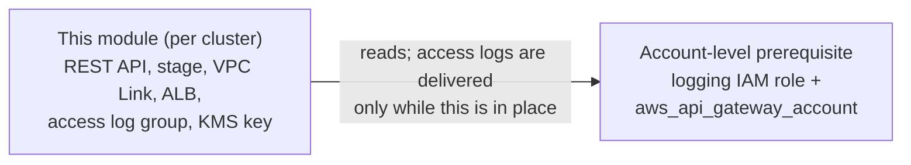

# API Gateway Module

Creates an API Gateway REST API with VPC Link integration to an internal ALB.

This creates the Internal ALB directly in Terraform, instead of relying on `Ingress` in EKS, in order to be able to set up the API Gateway integrations during the Terraform step.

The TargetGroup ARN needs to be available to the ArgoCD's Platform API helm chart, for it to create a `TargetGroupBinding` pointing at the ALB, in order to register the backend pod IPs with the target group.

## Architecture

```
Client (awscurl with SigV4)
    │
    ▼
API Gateway (AWS_IAM auth)
    │
    ▼ /{proxy+} ANY
    │
VPC Link v2
    │
    ▼
Internal ALB (:80)
    │
    ▼
Target Group (IP type, empty)
    │
    ▼ (populated by TargetGroupBinding)
    │
Backend Pods (:8000)
```

## Account-Level Access Logging (prerequisite)

API Gateway will not deliver stage access logs until the account-level settings name an
IAM role it can assume. AWS stores that setting **once per AWS account and region**,
shared by every REST API in the account — including the separate RHOBS gateway.

This module does **not** manage it. The role and the account setting are provisioned once
per AWS account and region, outside this repository, with a lifetime longer than any
regional cluster; the module only reads the role named by `var.cloudwatch_role_name` for
an advisory diagnostic.



The prerequisite is mandatory: the stage enables execution logging, which API Gateway
rejects while the account has no logging role. The `check` block names the role it looked
for on the plan, so a missing prerequisite is diagnosable instead of surfacing only as a
`BadRequestException` at apply time. Provision the account before the first cluster.

That check is advisory only. It looks the role up by name and text-matches
`apigateway.amazonaws.com` in its trust policy; it does not read the account's
`cloudwatchRoleArn` setting, evaluate the trust policy, confirm the managed policy is
attached, or verify that logs are delivered. A clean plan means "a role with this name
exists and its trust policy text mentions API Gateway", not "the prerequisite is correctly
configured" — see
[Diagnostic scope](../../../docs/design/api-gateway-account-ownership.md#diagnostic-scope).

The `removed` blocks in `main.tf` hand the previously cluster-owned copies back without
deleting them, and `terraform/config/regional-cluster/pre-destroy.sh` covers states torn
down before they apply the handover. Both are transitional; see
[API Gateway Account Ownership](../../../docs/design/api-gateway-account-ownership.md).

## Connecting the Backend

After Terraform creates the infrastructure, deploy a `TargetGroupBinding` in Kubernetes
to register pod IPs with the target group:

```yaml
apiVersion: elbv2.k8s.aws/v1beta1
kind: TargetGroupBinding
metadata:
  name: platform-api
  namespace: platform-api
spec:
  serviceRef:
    name: platform-api
    port: 8000
  targetGroupARN: <target_group_arn from terraform output>
  targetType: ip
```

## Testing

Use `awscurl` to send SigV4-signed requests:

```bash
# Get the invoke URL
terraform output -raw invoke_url

# Test the API
awscurl --service execute-api --region us-west-2 \
  https://abc123.execute-api.us-west-2.amazonaws.com/prod/api/v0/live
```
