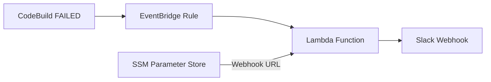

# CodeBuild Notifications Module

Automated Slack notifications for AWS CodeBuild failures using EventBridge and Lambda. Central bootstrap currently enables this module only for the platform-image build project; RC/MC projects are not included.

## Architecture



## Usage

```hcl
module "codebuild_notifications" {
  source = "../codebuild-notifications"

  slack_webhook_ssm_param = "/rosa-regional/slack/webhook-url"
  name_prefix             = "my-project"
  project_names           = ["my-project-build-platform-image"]
}
```

## Inputs

| Name                      | Description                                                                                                              | Type         | Required | Default |
| ------------------------- | ------------------------------------------------------------------------------------------------------------------------ | ------------ | -------- | ------- |
| `slack_webhook_ssm_param` | SSM Parameter path containing webhook URL                                                                                | string       | Yes      | -       |
| `name_prefix`             | Prefix for resource names                                                                                                | string       | No       | `""`    |
| `project_names`           | List of CodeBuild project names to monitor for `FAILED` builds. Only failures from these projects trigger notifications. | list(string) | Yes      | -       |

## Setup

### 1. Store Slack Webhook in SSM Parameter Store

```bash
aws ssm put-parameter \
  --name "/rosa-regional/slack/webhook-url" \
  --value "https://hooks.slack.com/services/T00000000/B00000000/XXXX" \
  --type "SecureString" \
  --description "Slack webhook for CodeBuild failure notifications"
```

### 2. Get Slack Webhook URL

1. Go to [Slack API: Incoming Webhooks](https://api.slack.com/messaging/webhooks)
2. Create or use existing app → Enable "Incoming Webhooks"
3. Add webhook to workspace and select channel
4. Copy webhook URL to use in SSM parameter above
